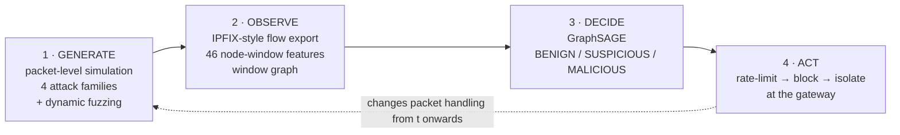

# NetShield-GNN

### Intelligent DDoS Detection and Automated Mitigation for IoT–Cloud Networks Using Dynamic Fuzzing and Graph Neural Networks

A **Computer Communication Networks** engineering project: a packet-level
discrete-event network simulator with **seven topology families**, **six
families of DDoS attack** with configurable rate waveforms, a dynamic fuzzing
engine, a GraphSAGE detector, and a mitigation loop that **closes inside the
running simulation** — so recovery is measured, not asserted.

Every experiment can also be re-run inside **a real NS-3 installation**
(ns-3.44), which is used to cross-validate the built-in engine.

> ⚠️ **All attack traffic is generated inside an in-memory simulator.** The
> simulation, feature and model code never opens a socket or uses a raw-socket
> API. The only network code is the receive-only IPFIX collector in
> `platform/service.py` and the optional Mininet testbed, which refuses any
> target outside its emulated 10.0.0.0/8. See [Safety and ethics](#safety-and-ethics).

---

## One-click start

| OS | Do this |
|---|---|
| Windows | double-click **`start.bat`** |
| Linux / macOS | `./start.sh` |
| Any | `python launch.py` |

The launcher creates `.venv` and installs every Python package. It finds
Node.js or downloads a portable copy, builds the operations console, and
installs the trained detectors, training them if none are present. It then
starts the server and opens **http://127.0.0.1:8000/app**. Re-running skips
finished steps. Useful flags: `--no-browser`, `--port 8080`, `--fresh`,
`--setup-only`.

## What is new in 2.0

| Area | Added |
|---|---|
| Rigour | 275-run grid (7 topologies x 7 scenarios x 4 seeds, plus benign stress); leave-one-seed, leave-one-topology and leave-one-family-out CV; run-level bootstrap CIs; Holm-corrected paired tests; ablations |
| Metrics | p50/p99 latency, RFC 3550 jitter, SLO availability, Jain fairness, flow completion time, collateral and suppression ratios; time to detect, mitigate and recover; rule churn; false alarms per device-hour; calibration (ECE, Brier) |
| Baselines | LightGBM, GRU sequence, one-class autoencoder, GATv2, E-GraphSAGE |
| Research | temporal GNN (GraphSAGE + GRU); temperature scaling and conformal response ladder; adaptive Bayesian adversary with stealth frontier and adversarial hardening; benign flash crowd, firmware and reboot storms |
| Real data | CICIoT2023 captures replayed through the simulator's own telemetry and feature code |
| Testbed | Mininet + Open vSwitch topology and agent; OpenFlow, nftables and P4Runtime rule export |
| Platform | IPFIX collector, Redis Streams pipeline, ONNX Runtime serving, JWT + RBAC, human approval queue, hash-chained audit log, Prometheus + Grafana, STIX 2.1 and CEF export, TimescaleDB schema, CI with coverage and benchmark gates |
| Console | React + TypeScript operations console: live topology, per-alert explanations (integrated gradients), synced incident timeline, approvals, replay, research results, command palette, dark mode |
| Engine | NS-3 is now the **primary** engine: real NS-3 networks built node-for-node for all seven topologies, run in WSL2 on Windows and natively on Linux, set up by one command |
| Speed | Python fallback engine 1.6x faster (buffered random draws) |

Read [`docs/RESEARCH_PROTOCOL.md`](docs/RESEARCH_PROTOCOL.md) for the methods,
[`results/reports/RESEARCH_RESULTS.md`](results/reports/RESEARCH_RESULTS.md)
for the numbers, and [`docs/PLATFORM.md`](docs/PLATFORM.md) for the platform.

## Classic pipeline

```bash
./run.sh setup      # probe dependencies, create directories, init the database
./run.sh all        # dataset → train → experiments → evaluate → dashboard
./run.sh demo       # two-minute live demonstration
```

On Windows without Git Bash, use the Python entry points directly — every
`run.sh` target maps to one script in `scripts/`.

---

## What it does



The dashed arrow is the point of the project. Mitigation is enforced inside the
packet path, so a rule installed at t = 40 s physically changes the run from
t = 40 s onwards.

### Topology families

The detector's advantage must not be an artefact of having exactly one choke
point, so every structural assumption of the baseline tree is varied:

| Family | What it changes |
|---|---|
| `tree` | Baseline: 4 tiers, one gateway, one path per device |
| `star` | No intermediate aggregation — the control condition for "does hierarchy matter" |
| `multi_gateway` | Several gateways; the botnet straddles enforcement domains |
| `dumbbell` | The bottleneck is a backbone span, not the edge uplink |
| `fat_tree` | Dual-homed edge routers — genuinely redundant paths |
| `mesh` | Ring + chords; multipath routing |
| `ring` | Single attachment point; structurally unequal path lengths |

### Attack families

| Family | Layer | Exhausts |
|---|---|---|
| `udp_flood` | volumetric | Link bandwidth |
| `icmp_flood` | volumetric | Packet rate, with no ports at all |
| `syn_flood` | protocol | The half-open connection backlog |
| `ack_flood` | protocol | Forwarding capacity, bypassing SYN defences |
| `http_flood` | application | The server worker pool |
| `slowloris` | application | The established-connection table |
| `mixed` | multi-vector | Weighted per-bot assignment of the above |

Rates are shaped by a `constant`, `ramp`, `sine` or `step` waveform, multiplied
by an optional on/off pulsing duty cycle, with per-bot rate jitter and staggered
join times — so a botnet is not a set of identical emitters sitting on one point
in feature space.

---

## Headline results

Full auto-generated results: **[`results/reports/RESULTS.md`](results/reports/RESULTS.md)**
Full write-up: **[`docs/FINAL_REPORT.md`](docs/FINAL_REPORT.md)**

**Detection** — test split, 3,331 node-windows from 7 held-out runs:

| Detector | Accuracy | Macro-F1 | Attack recall | False-positive rate |
|---|---:|---:|---:|---:|
| Threshold (calibrated) | 0.7247 | 0.4070 | 0.4732 | **22.3%** |
| Random Forest | 0.9913 | 0.8615 | 1.0000 | 0.14% |
| **GraphSAGE** | **0.9928** | **0.8672** | 1.0000 | 0.44% |

**Where the graph model actually wins** — two out-of-distribution scenarios in
which the per-node evidence is absent by construction, so a tabular model has
nothing to key on. No model was retrained for either:

| Scenario | Threshold | Random Forest | GraphSAGE |
|---|---|---|---|
| `exp17_slowloris` (8 quiet bots) | 8/8, **18** false-alarm nodes | **0/8 found** | **8/8, zero false alarms** |
| `exp15_icmp_flood` (no ports at all) | 4/4, **15** | **0/4 found** | **3/4**, zero |

A slowloris bot opens a socket every few seconds and dribbles a few bytes: its
own feature row looks like a lightly loaded sensor. What is anomalous is
*relational*, and two rounds of message passing put that evidence in each bot's
embedding.

**Structural generalisation** — the same attack on six topologies never seen in
training (star, multi-gateway, dumbbell, fat-tree, mesh, ring): both learned
detectors find **every** bot with **zero** false alarms on all six, while the
threshold rule misclassifies 17–21 innocent devices on each. On loud attacks
GraphSAGE and the Random Forest are *identical* — the graph adds nothing there,
and this README does not pretend otherwise.

**Generalisation** — `exp7_unseen`, whose attack parameters lie outside every
training range and on which no model was fitted:

| Detector | Bots found | Bots missed | False-alarm nodes |
|---|---:|---:|---:|
| Threshold | 7 / 7 | 0 | **21** |
| Random Forest | **5 / 7** | 2 | 0 |
| **GraphSAGE** | **7 / 7** | **0** | **0** |

**Closed-loop mitigation** — `exp8_mitigation`, 6 bots at 1,500 pkt/s:

| Phase (disjoint) | Uplink use | Clean loss | Clean latency |
|---|---:|---:|---:|
| Normal | 1.7% | 0.07% | 20.2 ms |
| Under attack, unmitigated | **99.9%** | **44.7%** | 37.4 ms |
| **Mitigated — attack still running** | **1.3%** | **0.06%** | 19.8 ms |

Detection latency **5.0 s** (one feature window) · **6/6** bots stopped ·
**zero** legitimate devices affected · recovery in **5.0 s**.

---

## Installation

**Requirements:** Python 3.10+. Nothing needs a C++ compiler.

```bash
git clone <repository-url> && cd netshield-gnn
python -m venv .venv
source .venv/bin/activate          # Windows: .venv\Scripts\activate
pip install -r requirements.txt
./run.sh setup
```

`./run.sh setup` runs `scripts/check_env.py`, which **imports every library and
executes every tool it reports on** — it never guesses. Optional components
(NS-3, PyTorch Geometric, Node, Docker) are reported but never fail the check;
each has a documented fallback.

### Docker

```bash
docker compose up            # dashboard on http://localhost:8000
docker compose run --rm netshield ./run.sh all
```

---

## Commands

| Command | What it does | Typical time |
|---|---|---|
| `./run.sh setup` | Dependency probe, directories, database | 10 s |
| `./run.sh dataset` | Simulate the corpus (28 runs) and featurise it | ~6 min |
| `./run.sh train` | Train all three detectors | ~1 min |
| `./run.sh experiments` | Run Experiments 1–8 | ~5 min |
| `./run.sh evaluate` | Metrics, figures, `RESULTS.md` | ~1 min |
| `./run.sh fuzz -c rate_sweep` | Run a fuzzing campaign | varies |
| `./run.sh dashboard` | API + dashboard on `:8000` | — |
| `--set simulation.engine=ns3` | Re-run any experiment inside real NS-3 | varies |
| `./run.sh demo` | Live narrated demonstration | ~2 min |
| `./run.sh test` | Automated test suite | ~2 min |
| `./run.sh all` | The whole pipeline, then the dashboard | ~13 min |
| `./run.sh clean` | Remove generated artefacts | — |

Add `--quick` to `dataset` for a fast smoke run, and `--reuse` to skip runs whose
artefacts already exist (run ids are a hash of the exact configuration, so a
reused run is byte-identical to a fresh one).

---

## The web console

```bash
./run.sh frontend build     # build the React bundle (once)
./run.sh dashboard          # serve API + console on :8000
```

| | |
|---|---|
| React console | <http://127.0.0.1:8000/app> |
| Bundled single-file dashboard | <http://127.0.0.1:8000/> |
| Swagger UI | <http://127.0.0.1:8000/docs> |
| ReDoc | <http://127.0.0.1:8000/redoc> |
| OpenAPI JSON | <http://127.0.0.1:8000/openapi.json> |

The console has eight views:

| View | What it does |
|---|---|
| **Live console** | KPI tiles, topology, time series, alert and mitigation logs, updating every window |
| **Attack builder** | Compose a custom attack + topology and launch it; validated server-side before it runs |
| **Experiments** | The full scenario matrix, runnable from the browser |
| **Topologies** | The seven families and their tunables |
| **Attack families** | The six families grouped by the resource they exhaust |
| **Results** | Detector comparison, per-scenario tables, figure gallery, generated reports |
| **Models** | Trained detector manifests and the live environment/NS-3 probe |
| **Run history** | Every persisted run |

### The attack builder, and why it is still safe

The builder sends sparse dotted-key configuration overrides to
`POST /api/simulation/start`. Those are checked against an **allowlist** in
`netshield.api.state.sanitise_overrides` before they are applied: only keys
under `attack.*`, `network.topology.*`, `mitigation.*`, `detection.*`,
`features.*`, `traffic.*` plus a few named `simulation.*` keys are accepted.
Anything else — `paths.*`, `api.host`, `simulation.engine` — is rejected with a
400.

This keeps the guarantee in [Safety and ethics](#safety-and-ethics) intact:
there is still no host, port, interface or real-world target parameter anywhere
in the API surface. `attack.target` accepts only a role (`cloud`, `gateway`) or
a node id belonging to the topology this process just built, and
`resolve_attack_target` raises `AttackSafetyError` for anything else.

`POST /api/attack/preview` resolves and validates a configuration *without*
running it, so the builder reports an impossible combination immediately rather
than after a simulation.

---

## Where things are

| Path | Contents |
|---|---|
| `config/` | `default.yaml` · `network.yaml` · `experiments.yaml` · `fuzzing.yaml` |
| `src/netshield/` | The package: `simulation` `traffic` `features` `graph` `models` `detection` `mitigation` `fuzzing` `evaluation` `database` `api` `utils` |
| `ns3/` | The **compiled and executed** NS-3 model + build script (see [`ns3/README.md`](ns3/README.md)) |
| `scripts/` | One entry point per pipeline stage |
| `tests/` | Six test suites |
| `data/processed/` | `dataset.csv` (12,863 rows) · `edges.csv` · `dataset_report.json` |
| `data/experiments/<run_id>/` | Per-run flows, window metrics, link stats, config snapshot |
| `models/` | `threshold/` `random_forest/` `graphsage/` — weights + scaler + manifest |
| `results/figures/` | All generated figures |
| `results/metrics/` | Metric bundles, comparison tables, latency reports |
| `results/reports/` | `RESULTS.md` + one report per experiment |
| `docs/` | Report · presentation · viva · architecture · methodology · experiments · API · troubleshooting |

---

## Documentation

| Document | Read it for |
|---|---|
| [`docs/FINAL_REPORT.md`](docs/FINAL_REPORT.md) | The complete engineering report |
| [`docs/PRESENTATION.md`](docs/PRESENTATION.md) | 20 slides with speaker notes |
| [`docs/VIVA.md`](docs/VIVA.md) | 50 viva questions with answers |
| [`docs/architecture.md`](docs/architecture.md) | Component and data-flow design |
| [`docs/methodology.md`](docs/methodology.md) | Exactly how everything is modelled |
| [`docs/experiments.md`](docs/experiments.md) | The experiment matrix, reproduction steps |
| [`docs/api.md`](docs/api.md) | REST API reference |
| [`docs/troubleshooting.md`](docs/troubleshooting.md) | When something does not work |

---

## Simulation engines and provenance

NS-3 is the **primary** engine. A scenario is turned into an exact
node-and-link specification and handed to a real NS-3 model, which builds that
network and runs genuine application and attack traffic over the real TCP/IP
stack. The Python discrete-event engine is the fast, fully-featured fallback
(and the only engine that enforces the closed mitigation loop). Every artefact
is stamped with the engine that produced it: the `engine` field of each
`run.json`, the `engine` column of `dataset.csv`, and the provenance caption of
every figure.

### NS-3 (primary)

The model lives in [`ns3/netshield/`](ns3/netshield/). The whole topology is
**data**: Python ([`ns3_spec.py`](src/netshield/simulation/ns3_spec.py)) emits
every node and link for any of the seven families, and the C++ builds it
generically — so a multi-gateway fabric or a mesh is a genuine NS-3 network of
real IoT end devices in their hierarchy, not a hard-coded shape. All traffic is
produced by NS-3's own application generators sending from each node's real
address through the real stack; the model never crafts a packet or forges an
address. Latency, loss and throughput are emergent, and the flow telemetry it
exports uses the project's own schema, so feature extraction, graph
construction and the detectors consume NS-3 output unchanged.

NS-3's shared libraries do not initialise on native Windows, so on Windows the
model runs inside **WSL2** (installed and driven automatically); on Linux it
runs directly. One command sets it up from a clean machine:

```bash
python scripts/setup_ns3.py        # WSL2 + Ubuntu + NS-3 + the model, then verifies
python scripts/setup_ns3.py --check
```

Then any scenario runs in NS-3 (the default when it is available):

```bash
python scripts/run_experiment.py --experiment exp13_mesh --set simulation.engine=ns3
```

Attack-family fidelity: volumetric UDP and application HTTP floods are genuine;
SYN, ACK, ICMP and slowloris run as labelled offered-load approximations on the
relevant transport and port; source spoofing is not reproduced. Each run
records exactly which approximations applied in `run.json`.

### The Python discrete-event engine (fallback, closed loop)

A genuine discrete-event simulator: store-and-forward switching, finite
drop-tail queues, serialisation and propagation delay, per-node processing
servers, a finite SYN backlog, a finite connection table and Reno TCP. It
implements all seven topologies, all six attack families, the rate-shaping
waveforms and — uniquely — the closed mitigation loop, so closed-loop runs
always use it. It is also the engine the committed research corpus was built
with, kept fixed so those results are reproducible.

## Safety and ethics

This is an **academic defensive-security simulator**. It provides no real-world
attack capability, and that is enforced by construction:

| Guarantee | Mechanism |
|---|---|
| No packet leaves the host | No module imports `socket`, `scapy` or any raw-socket API. "Packets" are Python objects on an in-memory heap. |
| Attacks target only simulated nodes | `Attacker.__init__` raises `AttackSafetyError` unless the target is a node in the in-process topology. |
| Spoofed addresses cannot alias a real device | Drawn from `10.66.0.0/16`, which the topology builder never assigns. A test asserts disjointness. |
| The API cannot be repurposed | There is no host, port or target parameter anywhere in the API surface. The only state-changing endpoints start and stop an in-process simulation. |
| Runaway configurations terminate | Per-run packet cap and wall-clock budget; an exhausted budget marks the run truncated and reports it. |

---

## Testing

```bash
pytest                       # all suites
pytest tests/test_simulation.py -v
```

The tests run **real simulations** rather than mocks, because the properties
worth asserting are network properties: that latency matches the physical path
delay, that a SYN flood exhausts a finite backlog while using little bandwidth,
that throughput never exceeds link capacity, that spoofing does not defeat
ingress-keyed mitigation, and that mitigation actually drops packets inside the
run.

The newer suite (`tests/test_topologies_and_attacks.py`) asserts the same way:
that every topology family routes every endpoint to the cloud, that a dumbbell's
bottleneck really is its backbone and not its edge, that fat-tree edge routers
really are dual-homed, that an ICMP flood carries no ports, that an ACK flood
carries no SYNs, and that a slowloris exhausts the connection table **while
using less bandwidth than a volumetric flood** — the property that makes it
worth implementing at all.

---

## License

MIT — see [`LICENSE`](LICENSE).
