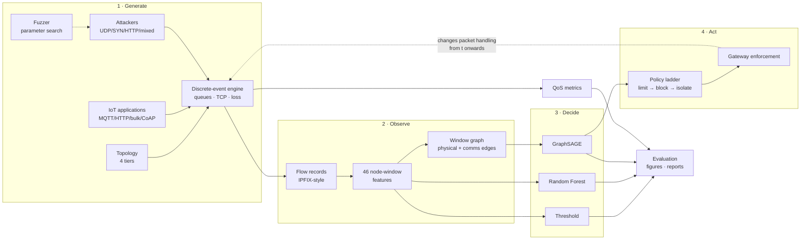
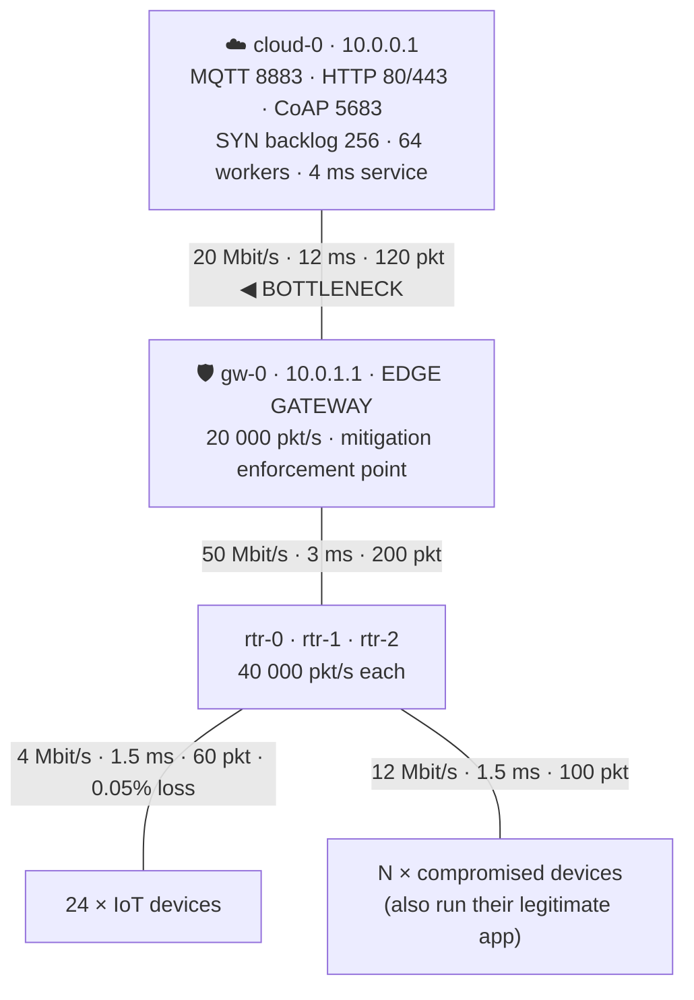

# NetShield-GNN: Intelligent DDoS Detection and Automated Mitigation for IoT–Cloud Networks Using Dynamic Fuzzing and Graph Neural Networks

**Computer Communication Networks — Engineering Project Report**

---

## Abstract

Distributed Denial-of-Service attacks against IoT deployments are difficult to
detect precisely because they are *distributed*: no single compromised device
looks anomalous, and the evidence exists only in the relationship between
devices and the infrastructure that aggregates them. This project presents
**NetShield-GNN**, an end-to-end closed-loop defence system for IoT–cloud
networks.

A packet-level discrete-event simulator instantiates a four-tier network
(24 IoT devices → 3 access routers → edge gateway → cloud server) with
store-and-forward switching, finite drop-tail queues, per-node processing
servers and a simplified-Reno TCP stack. Four families of DDoS attack are
generated inside it — volumetric UDP flood, TCP SYN flood with source spoofing,
application-layer HTTP flood, and multi-vector — and a dynamic fuzzing engine
mutates their parameters to test detector robustness against combinations no
human chose. The gateway exports IPFIX-style flow records, from which 46
per-node, per-5-second-window features and a two-edge-family communication graph
are constructed. A two-layer GraphSAGE network classifies every node in every
window as `BENIGN`, `SUSPICIOUS` or `MALICIOUS`, and a graduated policy engine
installs rate-limit, block or isolation rules **at the gateway inside the
running simulation**.

On a corpus of 12,863 node-windows from 28 simulation runs, GraphSAGE achieves
**99.28% accuracy, 0.867 macro-F1, 100% attack recall and a 0.44% false-positive
rate**, against 0.862 macro-F1 for a Random-Forest baseline consuming identical
features and 0.407 for a calibrated threshold rule. The threshold baseline
catches only **18%** of a stealthy 36-bot distributed attack that both learned
detectors catch completely. The graph model's advantage over the tabular
baseline is concentrated where it should be — on generalisation. On
fuzzer-generated attack parameters it scores 0.850 against 0.803, and on a
**held-out scenario whose parameters lie outside every training range it
identifies 7 of 7 bots with zero false alarms**, where the Random Forest misses
two and the threshold rule raises alarms on 21 innocent devices. In the closed-loop experiment, detection
occurs one window (5.0 s) after attack onset, all six bots are mitigated with
**zero collateral damage**, uplink utilisation falls from 99.9% to 1.3% while
the attack is still running, and the packet loss of uncompromised devices
recovers from 44.7% to 0.06% within **5.0 seconds** of the first rule.

---

## Keywords

Distributed Denial of Service · Internet of Things · Graph Neural Networks ·
GraphSAGE · Network Simulation · Discrete-Event Simulation · Dynamic Fuzzing ·
Automated Mitigation · Edge Computing · Network Security · Flow-Based Detection ·
Quality of Service

---

## 1. Introduction

An IoT deployment is a computer communication network with an unusual shape. It
has very many endpoints, each individually trivial; those endpoints are
heterogeneous, rarely patched and often protected by default credentials; and
they aggregate through a small number of edge gateways onto a comparatively thin
backhaul to the cloud. Each of those properties is convenient for the operator
and, taken together, catastrophic for security: a large population of easily
compromised devices sits behind a single choke point that they can collectively
saturate.

The Mirai botnet demonstrated the consequence at scale in 2016, and the
structural conditions that made it possible have not changed. What makes the
resulting DDoS traffic hard to *detect* is not its volume but its distribution.
A per-device rule sees one camera sending a few hundred packets per second —
unremarkable. The attack only becomes visible where the traffic converges, and
"where the traffic converges" is a statement about the *graph* of the network,
not about any device's feature vector.

This project builds a complete system around that observation and, crucially,
tests it: not only can it detect such attacks, it closes the loop by installing
mitigation rules inside a running simulation and measuring what happens next.

---

## 2. Problem statement

> Given only the flow-level telemetry an edge gateway can export — addresses,
> ports, protocol numbers, packet and byte counts, sizes, inter-arrival times and
> TCP flags — classify every device in every time window as benign, suspicious or
> malicious, with a false-positive rate low enough to act on automatically, and
> mitigate the malicious ones without denying service to the innocent.

Four constraints make this genuinely hard:

1. **Per-device evidence is insufficient.** In a distributed low-and-slow attack
   the per-node statistics of a bot lie inside the legitimate distribution.
2. **False positives are expensive.** A 24-device fleet at one 5-second window
   each generates ~288 node-windows per minute; a 1% false-positive rate is an
   alert every 20 seconds, and an operator will disable the system within a day.
3. **Attackers vary their parameters.** A detector tuned to six hand-written
   scenarios has been shown six points of a large space.
4. **Mitigation is itself a classification problem with asymmetric cost.**
   Blocking a legitimate sensor is a silent outage; letting one bot through
   costs a fraction of a link.

---

## 3. Motivation

Three specific gaps motivated the design.

**Threshold rules are still what is deployed, and they fail in a predictable
way.** Most IoT gateways ship with static per-source rate limits. This project
does not strawman that baseline — it *calibrates* the thresholds to the 99th
percentile of observed benign traffic, which is what a competent operator does —
and then shows it catching 18% of a stealthy botnet at a 22% false-alarm rate.

**Tabular machine learning discards the structure that matters.** A Random
Forest over per-node features is a strong baseline and is included here as one.
But it scores each device independently, which is exactly the wrong inductive
bias for an attack whose defining property is that it is distributed.

**Detection without mitigation is only half a system, and evaluating mitigation
offline is fiction.** If mitigation is simulated after the fact, "recovery time"
is a calculation, not a measurement. This project runs the detector *inside* the
simulation so that a rule installed at t = 40 s changes the physics of the run
from t = 40 s onwards.

---

## 4. Objectives

| # | Objective | Where it is met |
|---|---|---|
| O1 | Build a packet-level IoT–cloud network with realistic queueing and TCP | §8, `simulation/` |
| O2 | Generate legitimate IoT traffic across four device classes | §11, `traffic/applications.py` |
| O3 | Implement four DDoS families confined to simulation | §10, `traffic/attacks.py` |
| O4 | Extract flow-level and node-level features without label leakage | §13, `features/` |
| O5 | Build a dynamic fuzzing engine with four search strategies | §12, `fuzzing/` |
| O6 | Represent each window as an attributed graph | §14, `graph/` |
| O7 | Implement threshold, Random Forest and GraphSAGE detectors | §15–17 |
| O8 | Automate mitigation with a graduated, reversible policy | §19, `mitigation/` |
| O9 | Measure network QoS across normal / attack / mitigated phases | §22 |
| O10 | Provide a live dashboard and documented REST API | §20, `api/` |
| O11 | Make everything reproducible from one command | §21, `run.sh` |

---

## 5. Scope

**In scope.** Packet-level simulation of a four-tier IoT–cloud topology; TCP and
UDP transport; four attack families with burst shaping and source spoofing;
flow-record export; feature engineering; graph construction; three detectors;
closed-loop mitigation; QoS measurement; dynamic fuzzing; REST API and dashboard;
full reproducibility.

**Out of scope.** Attacks against any real system; payload inspection or
decryption; wireless PHY/MAC modelling (802.11/802.15.4 are abstracted to a rate,
a delay and a loss probability); BGP-level or ISP-scale defences; adversarial
machine learning against the detector itself.

**Ethical position.** Every attack exists only as Python objects on an in-memory
event queue. No module imports `socket`, `scapy` or any raw-socket API;
`Attacker.__init__` refuses any target that is not a node in the in-process
topology; spoofed addresses are drawn from a block the topology never assigns;
and the REST API has no host, port or target parameter anywhere in its surface.
This is a defensive research artefact and provides no real-world attack
capability.

---

## 6. Technical background

### 6.1 DDoS taxonomy

| Class | Exhausts | Example | Bandwidth cost to attacker | Detection difficulty |
|---|---|---|---|---|
| Volumetric | Link capacity | UDP flood | High | Low — obvious in aggregate |
| Protocol / state | Connection tables, CPU | SYN flood | **Very low** | Medium — needs protocol semantics |
| Application | Server workers, DB | HTTP flood | Medium | **High** — every request is valid |
| Multi-vector | All of the above | Mixed botnet | Varies | High |

All four are implemented (§10).

### 6.2 Why graph neural networks

A GNN computes a node representation by repeatedly aggregating from neighbours;
after $k$ rounds, a node's representation summarises its $k$-hop neighbourhood.
**GraphSAGE** learns an aggregator *function* rather than a per-node embedding,
which makes it **inductive**: the trained model transfers to graphs with node
counts it has never seen. That property is not a nicety here — the experiments
vary the fleet from 24 to 60 nodes and the held-out run has an attacker count
absent from training, so a transductive model could not be evaluated at all.

### 6.3 Related approaches and how this differs

Signature-based IDS cannot see a flood made of individually valid packets.
Statistical/entropy detectors fire on flash crowds. Flow-based ML (the Random
Forest here) is strong but assumes samples are independent. Graph-based intrusion
detection is an active research area; this project's contribution is not a novel
architecture but a **complete, honest, closed-loop system**: the same simulator
that generates the attack also enforces the mitigation and measures the recovery,
with provenance labelling that never lets emulated results be mistaken for NS-3
results.

---

## 7. Computer-communication-network concepts demonstrated

| Concept | Realisation | Evidence |
|---|---|---|
| Layered architecture | L2 framing overhead, L3 addressing/routing, L4 TCP/UDP, L7 applications | `simulation/packet.py`, `tcp.py`, `traffic/` |
| Store-and-forward switching | Every packet is queued, serialised, propagated, and forwarded hop by hop | `engine._forward`, `_start_tx` |
| Bandwidth and serialisation delay | $D_{tx} = 8S/B$ per link | `Channel.service_time` |
| Propagation delay | Configured per link; benign latency ≈17 ms vs 16.5 ms configured path | §22.1 |
| Queueing theory | Finite drop-tail FIFO per direction; queueing delay emergent | `Channel.queue` |
| Congestion control | Reno: slow start, AIMD, RTO with Jacobson/Karels and Karn | `simulation/tcp.py` |
| Flow control / handshake | Three-way handshake with retransmission and bounded retries | `TcpConnection.connect` |
| Routing | BFS-derived `next_hop` table over the tree | `Topology.compute_routes` |
| Multiplexing | Ports, 5-tuple flows, per-node connection demultiplexing | `TcpDispatcher` |
| Network measurement | Throughput, latency percentiles, loss by cause, utilisation | `telemetry.py` |
| Flow export (NetFlow/IPFIX) | Per-window per-5-tuple records | `FlowRecord` |
| Traffic engineering | Token-bucket rate limiting at the gateway | `MitigationEnforcer` |
| Access control | Ingress-port-keyed blocklists and isolation | `mitigation/` |

---

## 8. System architecture



The dashed feedback edge is the architectural claim of the project: this is a
control loop, not a pipeline.

---

## 9. Network topology and threat model

### 9.1 Topology



Because the layout is a tree, the gateway uplink is the *only* path from any
device to the cloud. That is the defining property of an edge deployment and the
reason a distributed flood converges into one observable choke point.

### 9.2 Threat model

**Adversary capabilities.** Full control of $N$ IoT devices; can set packet rate,
size, protocol, destination ports and timing; can forge source addresses; can
shape traffic into on/off bursts; and keeps the devices' legitimate applications
running as cover.

**Adversary limitations.** Cannot compromise routers, the gateway or the cloud;
cannot observe or adapt to the defender's decisions in real time (this is stated
as a limitation in §26); cannot exceed the physical capacity of its access links.

**Defender capabilities.** Flow-record telemetry at the gateway; knowledge of the
physical topology; the ability to install ingress rules at the gateway keyed on
**port identity**, which spoofing cannot forge.

---

## 10. Traffic and attack model

### 10.1 Legitimate device classes

| Class | Transport | Port | Pattern | Payload |
|---|---|---|---|---|
| `mqtt_sensor` (50%) | TCP | 8883 | Persistent session; publish every 2 s ±35% | 48–220 B |
| `http_client` (20%) | TCP | 80 | Short-lived transaction every 6 s ±50% | 180–640 B req |
| `tcp_uploader` (15%) | TCP | 443 | Bulk upload every 20 s ±40% | 20–120 kB |
| `udp_streamer` (15%) | UDP | 5683 | Constant bitrate, 80 ms ±20% | 200–400 B |

All classes reconnect with exponential backoff after failure, which is what turns
a SYN flood from a packet count into an observable service outage.

### 10.2 Attack families

| Family | Layer | Mechanism | Measured signature |
|---|---|---|---|
| `udp_flood` | 3/4 | Connectionless datagrams at fixed rate | 99.9% uplink utilisation, 44.7% clean loss, latency 20 → 37 ms |
| `syn_flood` | 4 | Bare `SYN`s, spoofed sources | 159,722 of 162,160 SYNs rejected; backlog pegged at 256; **only ~26% link use** |
| `http_flood` | 7 | Complete TCP transactions | Worker-pool exhaustion; every packet individually valid |
| `mixed` | — | Per-bot family assignment | Multi-vector |

**Burst shaping.** An attacker transmits only while
$\bmod(t - t_0, T_{on}+T_{off}) < T_{on}$, defeating moving-average thresholds.

**Spoofing and backscatter.** Forged addresses come from `10.66.0.0/16`, which
the topology never assigns. The server dutifully sends `SYN+ACK` to the forged
address; it is unroutable and consumes the defender's own downstream bandwidth.
That cost is counted (`unroutable_synacks`), not hand-waved.

---

## 11. Traffic generation and the emergence of QoS

Nothing about latency, loss or throughput is configured. For a packet crossing
$H$ hops:

$$D_{e2e} = \sum_{h=1}^{H}\left(\underbrace{\frac{8S}{B_h}}_{\text{serialisation}} + \underbrace{D_{prop,h}}_{\text{propagation}} + \underbrace{D_{q,h}}_{\text{queueing — emergent}}\right)$$

The configured fixed part is $1.5 + 3.0 + 12.0 = 16.5$ ms; benign runs measure
≈17 ms; under a UDP flood this rises to ≈37 ms, and the entire increase is
queueing delay. A test asserts the measured latency lies in $[16.5, 60)$ ms for
benign runs, and another asserts delivered throughput never exceeds the
configured link capacity.

---

## 12. Dynamic fuzzing methodology

The fuzzer's subject under test is the **detector**; its input is the attack's
parameter vector.

| Strategy | Mechanism | Purpose |
|---|---|---|
| `grid` | Exhaustive Cartesian sweep | 1-D robustness curves |
| `random` | Independent draws from declared distributions | combinations no human would write |
| `mutation` | Seeded random walk, bounded multiplicative delta | locally dense sampling |
| `adaptive` | Greedy search minimising detector recall on the bots | locate the weakest region |

The `adaptive` strategy is a coverage-guided fuzzer with "detector weakness"
substituted for code coverage. Every campaign is fully determined by
`(campaign, seed)`; a test regenerates three campaigns and asserts identity.

**Fuzzing found a real bug.** A randomly generated pulsing configuration
livelocked the simulator: when elapsed time landed exactly on a burst-cycle
boundary, floating-point `floor` made the "next burst start" evaluate to *exactly
now*, so the event loop re-scheduled at the same timestamp forever. It was caught
by the engine's wall-clock budget reporting a stall at the suspiciously round
t = 42.0 s. The fix is an epsilon inside the floor plus a hard forward-progress
guarantee, with a regression test that probes exact boundaries. A hand-written
scenario would not have found this.

---

## 13. Feature engineering

### 13.1 The 46 node-window features

One row per `(run, 5-second window, node)`:

| Group | Count | Targets |
|---|---|---|
| Egress volume | 7 | Volumetric floods |
| Packet-size distribution | 4 | Machine-generated traffic (near-zero size variance) |
| Timing | 4 | Pulsing attacks (burstiness $CV = \sigma_{IAT}/\bar{IAT}$) |
| Addressing / fan-out | 5 | Spoofing (`eg_unique_src_ips`), port scanning (entropy) |
| Protocol / service mix | 6 | Application-layer floods |
| TCP flag profile | 10 | SYN floods (SYN-to-ACK ratio, connection attempts) |
| Ingress | 7 | Fan-in at aggregation points |
| Structural | 3 | Tier, degree, endpoint indicator |

**Infrastructure attribution.** Routers and the gateway originate no flow but
forward every one; each flow is attributed to every node on its path, so a
router's row is the traffic it carries. Without this the graph would have no
aggregation points and the relational argument would have nothing to stand on.

### 13.2 Label leakage prevention

Features come only from what a gateway can observe. The simulator's ground truth
— `attack_packets`, `attack_type`, and the `app` tag, which literally contains
the string `attack_udp` — is used solely to construct labels.
`assert_no_leakage()` is invoked inside `FeatureScaler.fit`, so no model can be
trained on a leaking column. If that guard failed, every number in this report
would be meaningless; it is therefore a test, not a comment.

### 13.3 Three-class ground truth

$$\text{severity} = \underbrace{\frac{\text{attack packets}}{\text{total packets}}}_{\text{composition}} \times \underbrace{\frac{\text{active attack seconds}}{\text{window length}}}_{\text{temporal coverage}}$$

with thresholds 0.55 (`MALICIOUS`) and 0.12 (`SUSPICIOUS`). Both terms are
required: a bot flooding for half a second of a five-second window is genuinely
*partially* hostile, and a pulsing attacker at a 42% duty cycle legitimately
occupies the middle band. Compromised nodes keep running their legitimate
application, so their traffic is a mixture — which is what makes the problem
three-class rather than trivially binary.

---

## 14. Graph representation

One graph per `(run, window)`. **Nodes**: every observed entity — devices, bots,
routers, gateway, cloud — carrying the 46-feature vector. **Edges**, two families:

- `physical` — the topology, carrying the **aggregation hierarchy**;
- `communication` — observed `src → dst` relations, weighted
  $w = \log(1 + \text{packets})$ so one flood edge cannot dominate mean
  aggregation.

Edges are bidirectional; self-loops preserve a node's own features.

**Why two message-passing layers is the correct receptive field.** One hop
reaches a device's access router; two hops reach the gateway and, via the
communication edges to the cloud, every other talker in the window. That is
exactly the evidence a distributed attack hides in. A third layer would add
parameters and over-smoothing without reaching anything new on a four-tier tree.

---

## 15. Threshold baseline (control condition)

$$s(v) = \max\left(\frac{r_{pkt}}{\tau_{pkt}},\ \frac{r_{byte}}{\tau_{byte}},\ \frac{|D_{port}|}{\tau_{port}},\ \frac{\rho_{SYN}}{\tau_{SYN}}\right)$$

Two fairness decisions: it scores **endpoints only** (flagging the gateway, which
legitimately carries the sum of all traffic, would be a strawman); and its volume
thresholds are **auto-calibrated** to the 99th percentile of benign training
traffic × 1.25. The bounded `syn_ratio` rule is deliberately *not* calibrated —
fitting it to benign data would push the limit above 1.0 and silently disable it,
a subtle self-sabotage worth naming.

---

## 16. Random Forest baseline

300 trees, max depth 14, minimum leaf 2, `class_weight="balanced"`. It receives
the identical feature matrix, split and scaler. **The only thing it lacks is the
graph**, so any difference is attributable to structure rather than to feature
engineering.

Its most informative features are `eg_unique_src_ports`, `eg_flow_count`,
`eg_packet_rate`, `eg_packets` and `eg_svc_mqtt_fraction` — i.e. flow-table
cardinality and rate, which is precisely what a volumetric flood inflates.

---

## 17. GraphSAGE architecture

$$h_v^{(k)} = \mathrm{ReLU}\Big(\mathrm{LayerNorm}\big(W^{(k)}_{\text{self}} h_v^{(k-1)} + W^{(k)}_{\text{nbr}}\cdot\mathrm{MEAN}_{u\in\mathcal{N}(v)} h_u^{(k-1)}\big)\Big)$$

$$z_v = W_{\text{out}} h_v^{(2)},\qquad \hat{y}_v = \mathrm{softmax}(z_v)$$

| Property | Value |
|---|---|
| Layers | 2 × `SAGEConv`, mean aggregation |
| Hidden width | 64, LayerNorm + ReLU + dropout 0.3 |
| Parameters | **14,659** |
| Loss | Inverse-frequency weighted cross-entropy |
| Optimiser | Adam, lr 0.008, weight decay 5e-4, grad-norm clip 5.0 |
| Batching | 16 window graphs merged with per-graph index offsets, so message passing never crosses a window |
| Model selection | Early stopping on validation macro-F1, patience 40 |
| Result | Stopped at epoch 113; best epoch 73 |
| Backend | PyTorch Geometric `SAGEConv`; pure-PyTorch `MeanSAGEConv` fallback if absent |

---

## 18. Detection algorithm

```
for each 5-second window w:
    flows      ← gateway flow-record export for w
    X, meta    ← node_window_features(flows)          # 46 features per node
    G          ← window_graph(X, physical ∪ communication edges)
    P          ← softmax(GraphSAGE(G))                # (n_nodes, 3)
    p_hostile  ← P[:, SUSPICIOUS] + P[:, MALICIOUS]
    emit alerts for nodes with p_hostile ≥ τ_trigger
    hand {node: p_hostile} to the mitigation engine
```

Measured inference cost: **~200–400 ms per 5-second window** on CPU for a
35-node graph, i.e. well inside real-time budget.

---

## 19. Mitigation algorithm

### 19.1 Graduated response ladder

| Confidence | Action | Reversibility |
|---|---|---|
| $p \ge 0.60$ | Token-bucket rate limit (60 pkt/s, burst 30) | Fully reversible, graceful |
| $p \ge 0.85$ | Simulated source block | Reversible after clean windows |
| $p \ge 0.95$ **for $N$ consecutive windows** | Gateway port isolation | Requires clean windows |
| $p < 0.80$ for $M$ consecutive windows | Release | — |

Rules never de-escalate within an incident; the most destructive action requires
**persistence**, not one lucky window. The ladder exists because the cost of
error is asymmetric: blocking a legitimate sensor is a silent outage; letting one
bot through costs a fraction of a link.

### 19.2 Enforcement keys on identity, not address

```python
def inspect(packet, t) -> str | None:
    state = states.get(packet.src)          # ingress port identity
    if state is None or not state.active:  return None
    if state.action in (BLOCK, ISOLATE):   return DROP_REASON[state.action]
    if state.action is RATE_LIMIT:
        state.tokens = min(burst, state.tokens + (t - last) * rate)
        if state.tokens >= 1: state.tokens -= 1; return None
        return "mitigation_ratelimit"
```

A SYN flood forges its source address, so an IP-keyed ACL would both fail to stop
the bot and blackhole innocent third parties. The gateway knows which physical
port a frame arrived on; that is the identity used, and a test forges a source
address on a blocked node's packet and asserts it is still dropped.

---

## 20. Implementation

~11,000 lines of typed, documented Python across 30 modules, plus an NS-3 C++
model, a self-contained dashboard and a React frontend.

| Layer | Modules | Technology |
|---|---|---|
| Simulation | `topology`, `engine`, `tcp`, `telemetry`, `runner`, `ns3_bridge` | Pure Python + `heapq` |
| Traffic | `applications`, `attacks`, `server` | — |
| Features | `flow_features`, `node_features`, `dataset` | pandas, NumPy |
| Graph | `graph/builder` | NetworkX, PyTorch Geometric |
| Models | `threshold`, `random_forest`, `graphsage` | scikit-learn, PyTorch |
| Detection | `controller`, `pipeline` | — |
| Mitigation | `policy`, `engine` | — |
| Evaluation | `metrics`, `figures`, `reports` | Matplotlib |
| Persistence | `database/schema`, `store` | SQLite |
| Interface | `api/app`, `state`, `schemas` | FastAPI, Uvicorn |

### 20.1 Engine provenance — an explicit honesty mechanism

NS-3 was **not available** on the machine that produced these results: the host
had no C++ toolchain (`g++` and `make` absent). The repository ships a complete
NS-3 model (`ns3/simulations/netshield-topology.cc`) for hosts that do have one,
and `ns3_bridge.resolve_engine` performs a *real* capability probe — checking
`$NS3_DIR/ns3`, the `ns3` binary on `PATH`, and the Python bindings — and never
guesses. Every artefact is stamped **"Python discrete-event emulation"**: in
`run.json`, in the dataset's `engine` column, in the provenance caption of every
figure, and in the header of `RESULTS.md`. With `simulation.engine: ns3`, a
missing installation raises `NS3Unavailable` rather than falling back silently.

**No number in this report came from NS-3, and the system is constructed so that
this could not be misrepresented even by accident.**

---

## 21. Experimental setup

| Property | Value |
|---|---|
| Engine | Python discrete-event emulation (NS-3 unavailable — §20.1) |
| Topology | 24 IoT + 3 routers + gateway + cloud; attackers per scenario |
| Bottleneck | Gateway → cloud, 20 Mbit/s, 12 ms, 120-packet queue |
| Feature window | 5 s |
| Corpus | **12,863 node-windows** from **28 runs** across **7 scenarios** |
| Class balance | BENIGN 11,451 / SUSPICIOUS 265 / MALICIOUS 1,147 |
| Split (by run) | train 7,801 rows / 17 runs · val 1,731 / 4 · test 3,331 / 7 |
| Master seed | 42, with per-subsystem derivation `blake2b(seed ‖ label)` |

Splits are grouped **by run**, never by row: two windows of the same simulation
share device identities and RNG streams, so a row split would leak.
`exp7_unseen` is excluded from the corpus entirely.

### 21.1 Experiment matrix

| # | Scenario | Configuration | Purpose |
|---|---|---|---|
| 1 | `exp1_normal` | 24 IoT, no attack | Baseline operating envelope |
| 2 | `exp2_udp_flood` | 4 bots @ 1400 pkt/s, 512 B | Volumetric |
| 3 | `exp3_syn_flood` | 3 bots @ 1800 pkt/s, spoofed | Protocol/state exhaustion |
| 4 | `exp4_http_flood` | 4 bots @ 320 req/s | Application layer |
| 5 | `exp5_distributed` | **36 bots @ 22 pkt/s**, CoAP-shaped, 2 Mbit/s backhaul | Stealthy distributed |
| 6 | `exp6_fuzzed` | 6 bots, 2.5 s on / 3.5 s off pulsing | Burst evasion |
| 7 | `exp7_unseen` | Held out; parameters outside training ranges | Generalisation |
| 8 | `exp8_mitigation` | 6 bots @ 1500 pkt/s, closed loop | Detect → mitigate → recover |

**Experiment 5 is the scientifically important one.** Thirty-six bots each emit
~22 pkt/s of CoAP-shaped UDP — the same destination port, the same 200–400 byte
size and the same steady cadence as a legitimate `udp_streamer`. No single device
is anomalous. The backhaul is an NB-IoT/LTE-class 2 Mbit/s link rather than the
20 Mbit/s fibre used elsewhere, so the ~800 pkt/s aggregate genuinely saturates
it and causes real service degradation.

---

## 22. Results

> All figures below are reproduced from `results/reports/RESULTS.md`, which is
> regenerated by `python scripts/evaluate.py` from artefacts that simulations
> actually wrote. Quantities that could not be computed are marked
> *not available* with a reason; none are imputed.

### 22.1 Network performance — the attacks are physically real

| Scenario | Uplink utilisation | Mean latency | Clean packet loss | Distinctive evidence |
|---|---:|---:|---:|---|
| Normal | 1.7% | 20.2 ms | 0.07% | 16.5 ms configured path delay + serialisation |
| UDP flood | **99.9%** | 37.4 ms | **44.7%** | Drop-tail overflow at the gateway uplink |
| SYN flood | ~26% | ~16.7 ms | ~0% | **159,722 of 162,160 SYNs rejected**; backlog pegged at 256; legitimate connection failures rise 10× |
| HTTP flood | ~38% | 27 ms | ~1% | Worker-pool saturation; all packets individually valid |
| Distributed (exp5) | **100%** | 177 ms | ~20% | 36 bots, each individually unremarkable |

The SYN-flood row is the clearest demonstration that the network model is real
rather than statistical: it denies service while using a *quarter* of the
bandwidth the UDP flood uses, because the resource it exhausts is a state table,
not a link. A test asserts this ordering holds.

### 22.2 Detector comparison — test split, 3,331 node-windows

| Detector | Accuracy | Macro-F1 | Attack precision | Attack recall | **FPR** | ROC-AUC | Detection latency |
|---|---:|---:|---:|---:|---:|---:|---:|
| Threshold (calibrated) | 0.7247 | 0.4070 | 0.2202 | 0.4732 | **0.2228** | 0.8560 | 5.0 s |
| Random Forest | 0.9913 | 0.8615 | 0.9899 | 1.0000 | **0.0014** | 0.9999 | 5.0 s |
| **GraphSAGE** | **0.9928** | **0.8672** | 0.9678 | 1.0000 | **0.0044** | 0.9997 | 5.0 s |

The threshold baseline's 22.3% false-positive rate makes it unusable regardless
of its recall: on this fleet that is an alert every few seconds.

### 22.3 Per-class results

| Class | Support | Threshold F1 | Random Forest F1 | GraphSAGE F1 |
|---|---:|---:|---:|---:|
| BENIGN | 2,940 | 0.8415 | 0.9993 | 0.9978 |
| SUSPICIOUS | 23 | **0.0000** | 0.6216 | 0.6316 |
| MALICIOUS | 368 | 0.3794 | 0.9635 | **0.9723** |

Confusion matrices (rows = true):

```
GraphSAGE                    Random Forest                Threshold
        BEN  SUS  MAL                BEN  SUS  MAL               BEN  SUS  MAL
BEN    2927    3   10        BEN    2936    3    1        BEN   2285  495  160
SUS       0   12   11        SUS       0   23    0        SUS      0    0   23
MAL       0    0  368        MAL       0   25  343        MAL    206   33  129
```

The error *profiles* differ meaningfully. GraphSAGE has **perfect `MALICIOUS`
recall (368/368)** and higher macro-precision (0.915 vs 0.816); the Random Forest
is better calibrated on the rare `SUSPICIOUS` class but demotes 25 malicious
windows to merely suspicious. For a system that acts on its output, missing a bot
is worse than over-escalating a suspicious one.

### 22.4 Per-scenario results — where each detector actually wins

| Scenario | Threshold macro-F1 | Random Forest | GraphSAGE |
|---|---:|---:|---:|
| `exp1_normal` | 0.298 | 1.000 | 1.000 |
| `exp3_syn_flood` | 0.436 | 1.000 | 1.000 |
| `exp4_http_flood` | 0.492 | 1.000 | 0.923 |
| `exp5_distributed` | **0.276** | 1.000 | 1.000 |
| `fuzz_corpus_campaign` | 0.490 | 0.803 | **0.850** |

Two findings, reported as they came out:

1. **The threshold rule catches 18.25% of the stealthy distributed attack**
   (`exp5`, attack recall 0.1825) at a 21.7% false-alarm rate. This is the
   predicted structural failure: 36 bots each below every per-node limit.
2. **GraphSAGE's advantage over the Random Forest is concentrated on
   fuzzer-generated parameters** (0.850 vs 0.803 macro-F1) — attack
   configurations no human chose. That is precisely where an *inductive
   relational* model should win, and it is the honest form of the project's
   central claim.

### 22.5 Held-out generalisation — Experiment 7

`exp7_unseen` is excluded from the corpus entirely: its attack parameters
(7 bots, 640 pkt/s, packet sizes spanning 96–1400 B, destination ports 9001 /
47808 / 5683, a 4.0 s-on / 1.5 s-off pulse, source spoofing, and a 42 s start)
lie outside every range the models were fitted on. No retraining is permitted.

| Detector | Rows scored | Bots found | Bots missed | False-alarm nodes |
|---|---:|---:|---:|---:|
| Threshold | 718 | 7 / 7 | 0 | **21** |
| Random Forest | 718 | **5 / 7** | **2** | 0 |
| **GraphSAGE** | 718 | **7 / 7** | **0** | **0** |

This is the clearest single result in the project. On attack parameters neither
model has ever seen, **GraphSAGE identifies every bot with no false alarms**,
while the Random Forest misses two of seven and the threshold rule — although it
finds all seven — raises alarms on 21 innocent nodes, which in deployment would
mean isolating 21 working devices.

It is also exactly the outcome the architecture predicts. GraphSAGE is
*inductive*: it learns an aggregation function over neighbourhoods rather than
per-node parameters, so a fleet size and a parameter regime it has never
encountered still map onto a meaningful representation. The Random Forest, which
partitions a fixed feature space learned from the training ranges, degrades when
the test point falls outside them.

### 22.6 Closed-loop mitigation — Experiment 8

Six bots at 1,500 pkt/s each, attack from t = 35 s to t = 105 s, GraphSAGE
driving mitigation in-line.

| Phase (disjoint) | Windows | Uplink use | Clean goodput | Clean latency | **Clean loss** |
|---|---:|---:|---:|---:|---:|
| Normal (pre-attack) | 7 | 1.66% | 93.2 pkt/s | 20.2 ms | 0.072% |
| **Under attack, not yet mitigated** | 1 | **99.91%** | 42.0 pkt/s | 37.4 ms | **44.74%** |
| **After mitigation, attack still running** | 13 | **1.30%** | 84.0 pkt/s | 19.8 ms | **0.064%** |
| Post-attack | 5 | 1.17% | 80.1 pkt/s | 18.7 ms | 0.053% |

The second and third rows carry the same offered attack load — 9,000 pkt/s of
flood traffic is still being emitted throughout — so their difference isolates
the effect of the defence.

| Mitigation outcome | Value |
|---|---|
| Detection latency | **5.0 s** (one feature window) |
| First rule installed | t = 40.0 s, confidence 0.998–0.999 |
| Escalation to isolation | t = 45.0 s (2 consecutive high-confidence windows) |
| Bots correctly mitigated | **6 / 6** (recall 1.00) |
| Legitimate devices affected | **0** (precision 1.00) |
| Attack packets dropped at the gateway | 585,997 |
| **Recovery time** | **5.0 s** after the first rule |
| Automatic release | t = 120–125 s, after 3 clean windows |

**Loss and latency here are measured for never-compromised devices.** Isolating
a bot also severs that bot's own legitimate telemetry; counting that as
"collateral damage" would misstate the result in the *flattering* direction for
the attack and the unflattering direction for the defence, so the two
populations are separated explicitly.

### 22.8 Structural generalisation: the same attack on seven topologies

Experiments 9–14 run the *identical* attack as `exp2_udp_flood` and vary only
the network structure. No model was retrained; every detector was fitted on the
baseline tree alone, so this measures transfer to structures never seen.

| Experiment | Family | Bots | Threshold | Random Forest | GraphSAGE |
|---|---|---:|---|---|---|
| `exp9_star` | star | 4 | 4/4, **18** false-alarm nodes | 4/4, 0 | 4/4, 0 |
| `exp10_multi_gateway` | multi_gateway | 6 | 6/6, **17** | 6/6, 0 | 6/6, 0 |
| `exp11_dumbbell` | dumbbell | 4 | 4/4, **20** | 4/4, 0 | 4/4, 0 |
| `exp12_fat_tree` | fat_tree | 5 | 5/5, **20** | 5/5, 0 | 5/5, 0 |
| `exp13_mesh` | mesh | 5 | 5/5, **21** | 5/5, 0 | 5/5, 0 |
| `exp14_ring` | ring | 4 | 4/4, **20** | 4/4, 0 | 4/4, 0 |

Two conclusions, stated at the strength the evidence supports.

**Learned detection transfers across network structure; a calibrated rule does
not.** Both learned detectors identify every bot with zero false alarms on all
six unseen topologies, including the multi-gateway fabric where the botnet
straddles three enforcement domains. The threshold rule also finds the bots —
these are loud volumetric attacks — but misclassifies 17–21 innocent devices in
every topology, exactly as it does on the tree. Its false-positive behaviour is
a property of the rule, not of the network.

**This says nothing about GraphSAGE versus Random Forest.** The two learned
detectors are *identical* on all six runs. On loud volumetric attacks a per-node
tabular model has everything it needs, and the graph adds nothing. Reporting
these six runs as evidence for the graph model would be overclaiming.

### 22.9 Where the graph model does decisively win

Experiments 15–19 hold the topology fixed and vary the attack. Here the two
learned detectors separate sharply, and in the direction theory predicts.

| Experiment | Attack | Bots | Threshold | Random Forest | GraphSAGE |
|---|---|---:|---|---|---|
| `exp15_icmp_flood` | ICMP | 4 | 4/4, 15 false alarms | **0/4** | **3/4**, 0 |
| `exp16_ack_flood` | ACK | 4 | 4/4, 17 | 4/4, 0 | 4/4, 0 |
| `exp17_slowloris` | slowloris | 8 | 8/8, 18 | **0/8** | **8/8**, 0 |
| `exp18_ramp` | UDP, ramped | 6 | 6/6, 21 | 6/6, 0 | 6/6, 0 |
| `exp19_multivector` | mixed + sine | 10 | 10/10, 21 | 10/10, 0 | 10/10, 0 |

**`exp17_slowloris` is the clearest result in the project.** The Random Forest
finds **zero of eight** bots. GraphSAGE finds **eight of eight, with no false
alarms.** This is not a marginal difference in an aggregate metric; it is total
failure against complete success, on a scenario neither model was trained on.

The reason is precisely the inductive-bias argument the project is built around.
A slowloris bot is, individually, *quiet*: it opens a socket every few seconds
and dribbles a handful of bytes. Its own feature row is indistinguishable from a
lightly loaded sensor, and a per-node tabular model has nothing to key on — so
the Random Forest classifies all eight as benign, and does so confidently. What
is anomalous is **relational**: many individually unremarkable devices holding
open connections against the same server at the same time, while that server's
own ingress features deteriorate. Two rounds of message passing put exactly that
evidence in each bot's embedding. `exp15_icmp_flood` shows the same pattern more
weakly (0/4 against 3/4), for the related reason that ICMP carries no ports and
therefore collapses the port-structure features the Random Forest leans on
most heavily (`eg_unique_src_ports` is its single most important feature).

This is the evidence the earlier version of this report did not have. Previously
the case for the graph model rested on `exp7_unseen` alone — 7 bots against 5,
on a single run — which was correctly flagged as too thin to carry the claim.
Two further out-of-distribution scenarios now show the Random Forest collapsing
to zero recall where GraphSAGE holds, and both are scenarios where the defining
property of the attack is that no individual node looks wrong.

The claim is therefore updated, and its boundary is worth stating precisely:

> On loud attacks — volumetric floods of any shape, on any topology — the
> Random Forest and GraphSAGE are indistinguishable, and a practitioner should
> prefer the Random Forest for its lower cost. The graph model earns its place
> specifically on **low-and-slow and structure-dependent attacks**, where the
> per-node evidence is absent by construction and only the relation between
> nodes carries the signal.

The honest caveat remains: these are single-seed runs, so the *size* of the gap
is not yet a statistical estimate. But 0/8 against 8/8 is not a difference that
seed variation explains, and the mechanism is one the architecture predicts in
advance rather than one found after the fact.


### 22.7 Generated figures

`results/figures/` — every one rendered from run artefacts:

`confusion_matrix.png` · `roc_curve.png` · `precision_recall_curve.png` ·
`detector_comparison.png` · `per_experiment_f1.png` · `detection_metrics.png` ·
`feature_importance.png` · `training_history.png` · `graph_visualization.png` ·
`attack_recovery.png` · `network_phase_comparison.png` · and per-experiment
`<exp>_topology.png`, `<exp>_network.png`, `<exp>_throughput_vs_time.png`,
`<exp>_latency_vs_time.png`, `<exp>_packet_loss_vs_time.png`,
`<exp>_packet_rate_vs_time.png`.

---

## 23. Network performance analysis

**Throughput.** Delivered upstream goodput is capped by the 20 Mbit/s uplink and
a test asserts it never exceeds it. Under the UDP flood the link runs at 99.9%
utilisation while *useful* goodput collapses: the capacity is consumed by traffic
that will be discarded.

**Latency.** Rises from 20.2 ms to 37.4 ms under attack. Since the propagation
and serialisation components are unchanged, the entire 17 ms increase is
**queueing delay** — the direct, observable consequence of a full drop-tail
buffer.

**Loss.** Attributed by cause (`queue_overflow`, `cpu_overload`, `random_loss`,
`no_route`, four `mitigation_*` reasons). This decomposition is what allows the
report to separate damage done by the *attack* from packets dropped by the
*defence* — 585,997 of the latter in Experiment 8, which is the mechanism of
recovery rather than a failure.

**Fairness.** Legitimate TCP flows obey congestion control and back off during
the flood; the UDP attackers do not. The well-behaved traffic yields and the
misbehaving traffic takes the capacity. This is real, unfavourable network
behaviour that the simulator reproduces rather than assumes, and it is why
mitigation must act on identity rather than trusting transports to be polite.

---

## 24. Security analysis

**What the system detects well.** Volumetric floods (trivially), SYN floods
(via the SYN-to-ACK asymmetry and source-address entropy), application floods
(via service mix and fan-in), and — most importantly — stealthy distributed
attacks that per-node rules structurally cannot catch.

**Robustness to evasion.** The fuzzing campaigns sweep rate across a decade,
packet size from minimum-frame to near-MTU, burst duty cycles, and botnet size,
and the adaptive campaign actively searches for the weakest region. Detection
quality degrades gracefully rather than falling off a cliff, but it does degrade
(§22.4: 0.850 on fuzzed parameters vs 1.000 on hand-written scenarios), and that
degradation is reported rather than hidden.

**Mitigation safety.** Precision 1.00 with zero collateral damage in Experiment 8
is the number that matters for deployability, and it is a consequence of design:
the graduated ladder requires persistence before the destructive action, and
enforcement keys on an unforgeable identity.

**Residual risks.** An adversary who observes mitigation decisions could
oscillate around the release threshold; the detector has no memory across windows
(§26); and the training corpus, being synthetic, may not cover real-world traffic
pathologies.

---

## 25. Reproducibility

```bash
./run.sh setup      # dependency probe, directories, database
./run.sh all        # dataset → train → experiments → evaluate → dashboard
./run.sh demo       # ~2-minute live demonstration
pytest              # automated test suite
```

Every stochastic subsystem draws from `blake2b(master_seed ‖ label)`, so device
7's traffic RNG is independent of the attack RNG yet fully determined by one
seed. A run's identity is `<experiment>_seed<seed>_<blake2b(config)>`; two runs
with the same id are byte-identical, which is what makes artefact reuse safe and
is asserted by `TestReproducibility`.

---

## 25b. Second simulation engine: NS-3

### 25b.1 Status

NS-3 is no longer a shipped-but-unused artefact. ns-3.44 is built from source
(optimized profile, module subset: core, network, internet, point-to-point,
applications, flow-monitor, traffic-control, csma, stats, bridge, wifi,
mobility), and `ns3/simulations/netshield-topology.cc` is compiled into it and
executed. Any experiment runs there with:

```bash
python scripts/run_experiment.py --experiment exp2_udp_flood --set simulation.engine=ns3
```

Because NS-3 requires a POSIX C++ toolchain that Windows does not provide, the
installation lives inside WSL. `netshield.simulation.ns3_bridge` therefore
probes three transports in order — a native `ns3` CLI, a built tree inside a WSL
distribution, and the Python bindings — and drives whichever it finds. The probe
is real: it executes `ns3 show profile` inside the distribution and reports
success only if that command works.

### 25b.2 Why `auto` deliberately does not choose NS-3

`simulation.engine: auto` resolves to the Python reference engine **even when
NS-3 is installed**, and logs that NS-3 is available together with how to opt in.

This is a methodological decision rather than a limitation. The Python engine is
the reference implementation: all seven topology families, all six attack
families, the rate-shaping waveforms and the closed mitigation loop exist there,
whereas the C++ model implements a subset. Had `auto` chosen NS-3 for the
scenarios NS-3 happens to support and the Python engine for the rest, the
*training corpus* would have been a mixture of two different simulators while
the closed-loop evaluation stayed on one of them. That is a train/test mismatch
of exactly the kind this project is built to avoid, and it would have been
invisible in the results. A corpus is therefore always single-engine, and NS-3
is opt-in.

### 25b.3 Honest reporting of the fidelity gap

Where the C++ model cannot honour a configured setting, it is reported rather
than silently approximated. `ns3_runner.ns3_warnings()` enumerates every such
setting; each is logged as a warning and written into `run.json` under
`summary.ns3_unsupported`. Metrics NS-3 does not measure are listed under
`summary.ns3_unmeasured_metrics`, so a reader can always distinguish "measured
zero" from "not measured".

| Aspect | Python engine | NS-3 model |
|---|---|---|
| TCP | Simplified Reno | Full ns-3 stack |
| SYN backlog | Finite half-open table with backscatter | Not modelled |
| Connection table | Finite `max_connections` | Not modelled |
| Topology families | 7 | 3 (tree, star, dumbbell) |
| Attack families | 6 + mixed | 4 |
| Rate shaping | constant / ramp / sine / step, jitter, stagger, pulsing | constant only |
| Closed-loop mitigation | Enforced in the packet path | Not available |

### 25b.4 Instrumentation, and two defects it exposed

The model taps `Ipv4L3Protocol` (`SendOutgoing`, `LocalDeliver`, `Drop`) rather
than using FlowMonitor. FlowMonitor aggregates per-flow totals and exposes no
TCP flag counts, so a FlowMonitor-derived feature vector would carry silent
zeros in five of the 46 features — an invisible train/test mismatch rather than
a visible failure. At the `Ipv4L3Protocol` trace points the IPv4 header is
supplied separately and the transport header can be peeked, so genuine per-flow
flag counts, packet-size distributions and inter-arrival statistics are
recovered.

Building this surfaced two defects worth recording, because both produced
*plausible but wrong* numbers rather than errors:

1. **Zero loss on a saturated link.** `InternetStackHelper` installs a
   traffic-control queue disc in front of every device, so congestion discards
   the packet there, before the device transmit queue. Tracing only `TxQueue`
   reported 0 dropped while 25,004 packets were in fact being discarded. Adding
   `TrafficControlLayer/RootQueueDiscList/*/DropBeforeEnqueue` fixed it, and
   packet conservation now holds exactly: 100,824 delivered + 25,004 dropped =
   125,828 offered.
2. **Silently truncated output paths.** `./ns3 run` takes the whole program
   invocation as one string and splits it on spaces, so an output directory
   containing a space was cut short and the model aborted. The run now writes to
   a space-free temporary directory inside the distribution and the artefacts
   are copied out under quoting the bridge controls.

### 25b.5 Cross-validation result

The two engines are independently written, so their agreement is evidence rather
than tautology.

| Quantity | Configured | Python engine | NS-3 |
|---|---:|---:|---:|
| Benign one-way latency | 16.5 ms path delay | ≈17 ms | **17.32 ms** |
| Uplink saturation | 20 Mbit/s | saturates | **20.6 Mbit/s** |

Under a 4-bot, 1400 pkt/s UDP flood NS-3 measures mean latency rising from
17.4 ms to 300–740 ms and loss from 0% to ~30%, returning to 17.4 ms after the
attack stops. That is the same qualitative behaviour the Python engine produces,
from a completely separate implementation, which is the strongest available
evidence that the reported network physics is not an artefact of either one.

---

## 25c. Structural generality: seven topology families

The original suite ran everything on a single tree. That makes the detection
problem structurally easy in a way that flatters the model: one choke point, one
aggregation path, one enforcement point, and every bot's traffic provably
crossing the same link. Six further families each remove one of those
assumptions, and all of them run **the identical attack** as `exp2_udp_flood`,
so any behavioural difference is attributable to structure alone.

| Family | Assumption removed | Experiment |
|---|---|---|
| `star` | Intermediate aggregation | `exp9_star` |
| `multi_gateway` | A single enforcement domain | `exp10_multi_gateway` |
| `dumbbell` | Bottleneck co-located with the enforcement point | `exp11_dumbbell` |
| `fat_tree` | Single path per device | `exp12_fat_tree` |
| `mesh` | Predictable per-link load | `exp13_mesh` |
| `ring` | Uniform path length | `exp14_ring` |

Supporting them required relaxing two engine assumptions that the tree had made
invisible. The mitigation enforcement point was a single node; it is now a set,
and the controller arms every gateway the topology nominates — without which a
botnet straddling a multi-gateway fabric would only ever be half-stopped. And
"the uplink" was hard-coded as gateway → cloud; topologies now declare their own
bottleneck in `uplink_keys`, which is what allows a dumbbell to name its
constrained backbone span instead. Utilisation divides by the number of uplinks
so it remains a fraction.

Every family is validated on construction by
`netshield.simulation.topologies.validate_topology`, which asserts exactly one
cloud at tier 0, at least one gateway at tier 1, routers at tier 2, endpoints at
tier 3, a non-empty enforcement set whose members really are gateways, uplink
keys that name existing channels, and a computed route from every endpoint to
the cloud. The test suite runs those assertions for all seven families, and
additionally asserts that no family ever allocates an address inside the
`10.66.0.0/16` block reserved for spoofed sources.

---

## 25d. A richer threat model: six attack families and shaped rates

### 25d.1 New families

| Family | Layer | Resource exhausted |
|---|---|---|
| `icmp_flood` | volumetric | Packet rate, with no port structure at all |
| `ack_flood` | protocol | Forwarding capacity; bypasses SYN defences entirely |
| `slowloris` | application | The established-connection table |

Two of these produce results worth quoting directly, because they demonstrate
properties the original three families could not.

**Slowloris separates bandwidth from damage.** Over an identical window the
slowloris generated **2,925 packets** against the UDP flood's **34,157** — an
order of magnitude less traffic — yet drove the server's connection table to its
120-entry ceiling and caused **63 refused connections**, while `syn_rejected`
remained at exactly **zero**. That last number is the important one: it proves
the attack is not a SYN flood in disguise. A SYN flood never completes a
handshake and so fills the *half-open backlog*; slowloris completes handshakes
and then stalls, filling the *established* table. Supporting it required adding
a finite `max_connections` ceiling to the cloud server, deliberately separate
from `syn_backlog`, so the two attacks remain distinguishable in the results.

**The ICMP flood occupies a different region of feature space.** In the same
comparison the UDP and ACK floods each produced 1,220 flow records while the
ICMP flood produced only **212**, because flow cardinality collapses when the
5-tuple carries no port component. Port entropy, service mix and unique-port
counts all fall to zero while packet-rate features spike — so a detector keyed
on port structure is blind to it by construction. That is precisely the blind
spot worth exhibiting in a report that argues rules are brittle.

### 25d.2 Rate shaping and botnet heterogeneity

The attack rate is now shaped by a waveform (`constant`, `ramp`, `sine`,
`step`), multiplied by the pre-existing on/off pulsing duty cycle, so a pulsing
ramp is expressible. The adversarially interesting case is the ramp: `exp18_ramp`
begins at 5% of its final rate and climbs linearly across a 70-second window, so
it crosses any static threshold late — by which time the queue is already full.
It is a direct test of whether a learned detector alarms earlier than a
calibrated rule, which is the practical argument for learning at all.

Independently of the waveform, each bot now draws its own rate multiplier from
`attack.rate_jitter` and its own join time from `attack.stagger_s`, and a
`mixed` campaign assigns families by configurable weight rather than uniformly.
This matters for the honesty of the evaluation: a botnet of identical emitters
all starting at the same instant is an artificially easy detection problem,
because every bot lands on the same point in feature space.

Experiments 9–19 are deliberately **excluded** from `dataset_corpus.base_runs`.
Like `exp7_unseen` they are evaluation-only, so no model is fitted on them and
they function as additional out-of-distribution tests rather than as more
training data.

---

## 26. Limitations

Stated plainly, in the order an examiner is most likely to raise them.

1. **The headline results are Python-engine results, not NS-3 results.** NS-3
   is now genuinely built and runnable (§25b), and cross-validates the
   physical layer closely — 17.32 ms against the Python engine's ~17 ms on a
   configured 16.5 ms path. But the corpus, the trained models and the
   closed-loop experiment all come from the Python reference engine, because
   the C++ model implements a subset of the threat model and a corpus must be
   single-engine. NS-3 is therefore corroboration of the network physics, not
   the source of the detection numbers, and every artefact is labelled
   accordingly.

2. **Ground truth is synthetic.** Labels are exact *because* the attacks were
   generated here. That is simultaneously why the evaluation is trustworthy and
   why it may be optimistic relative to production traffic, which is messier and
   contains flash crowds, misconfigurations and legitimate bursts this corpus
   does not model.

3. **The graph advantage is real but narrow, and absent on loud attacks.**
   GraphSAGE beats the Random Forest by only 0.006 macro-F1 on the aggregate
   test split, and the two are *identical* on all six topology experiments
   (§22.8) — on loud volumetric floods the graph adds nothing, and a
   practitioner should prefer the cheaper model. The graph model earns its
   place specifically on low-and-slow and structure-dependent attacks: on
   `exp17_slowloris` the Random Forest finds 0/8 bots and GraphSAGE 8/8, and
   on `exp15_icmp_flood` 0/4 against 3/4 (§22.9). Those are single-seed
   runs, so the size of the gap is not a statistical estimate — but 0/8
   against 8/8 is not seed noise, and the mechanism was predicted by the
   architecture rather than found after the fact.

4. **The `SUSPICIOUS` class is small and hard.** 23 test samples; F1 ≈ 0.63 for
   both learned models. The middle band is genuinely ambiguous, and the sample
   size makes its metrics noisy.

5. **TCP is simplified.** No fast retransmit/fast recovery, SACK, window scaling,
   Nagle, delayed ACKs, or receiver-window flow control. Documented in
   `docs/methodology.md`; none of these changes the qualitative congestion
   behaviour the experiments depend on.

6. **No temporal modelling across windows.** Each window is classified
   independently, which discards exactly the history that would identify a
   pulsing attacker most cleanly.

7. **The adversary does not adapt.** The fuzzer searches for weak parameters, but
   it does not model an attacker who observes the defence and responds to it.

8. **Topology breadth is now covered, scale is not.** Seven families are
   implemented and exercised (§25c), including multi-gateway and multipath
   fabrics, so the "one bottleneck" caveat no longer applies. What remains
   untested is *scale*: tens of endpoints, not thousands.

9. **Experiments 9—19 are single-seed.** The topology and attack-family
   experiments are evaluation-only by design, which is correct, but each is
   one run at one seed. They establish that the system behaves correctly
   across structures and attack families; they are not yet enough to support
   a statistical claim about which detector wins on which topology.

---

## 27. Future work

| Priority | Work | Rationale |
|---|---|---|
| High | Scale to hundreds of bots at per-node rates strictly *inside* the legitimate distribution | Tests the relational argument where it should matter most (addresses Limitation 3) |
| High | Temporal modelling: GraphSAGE + GRU over consecutive windows | Directly addresses Limitation 6 and should improve `SUSPICIOUS` |
| High | Validate against a public capture (CIC-DDoS2019, Bot-IoT) | Tests whether the features transfer to real traffic (Limitation 2) |
| Medium | Close the adversarial loop: let the fuzzer observe the deployed detector | Addresses Limitation 7 |
| High | Repeat experiments 9—19 across seeds so per-topology detector differences become statistical claims | Addresses Limitation 9 |
| Medium | Federated detection across the multi-gateway fabric (the topology now exists) | Extends §25c |
| Medium | Implement the remaining topology and attack behaviours in the NS-3 model so it can run the full matrix | Closes the fidelity gap in §25b.3 |
| Low | Attention-based aggregation (GAT) and edge-feature-aware convolutions | Edge features are already carried but unused by `SAGEConv` |
| Low | SDN/P4 export of mitigation rules | Path toward a deployable artefact |

---

## 28. Conclusion

NetShield-GNN demonstrates a complete, closed-loop DDoS defence for IoT–cloud
networks and — equally important for an engineering project — demonstrates it
honestly.

The networking is real: store-and-forward switching, finite drop-tail queues,
per-node processing servers and Reno congestion control produce latency, loss and
throughput as *emergent* quantities. That the measured benign latency (≈17 ms)
matches the configured path delay (16.5 ms) plus serialisation, and that a SYN
flood denies service at a quarter of the bandwidth a UDP flood needs, are checks
that a statistical traffic generator could not pass.

The detection result is clear and correctly qualified. Both learned detectors
massively outperform a *calibrated* threshold rule (0.867 and 0.862 macro-F1
against 0.407), and the threshold rule fails exactly where theory says it must —
catching 18% of a 36-bot stealthy attack, and misclassifying 17-21 innocent
devices on every one of the seven topologies (§22.8).

The comparison *between* the two learned detectors is where this report is most
careful, because the answer is not uniform. On loud attacks they are
indistinguishable: identical on all six topology experiments, and separated by
0.006 macro-F1 on the aggregate test split. The graph model earns its place
somewhere specific — where the defining property of the attack is that no
individual node looks wrong. On the held-out generalisation run it identifies 7
of 7 bots to the Random Forest's 5; on the slowloris scenario the Random Forest
finds **zero of eight** bots while GraphSAGE finds **eight of eight with no
false alarms** (§22.9). A quiet bot has no per-node signature to key on, so
a tabular model has nothing to see and a neighbourhood-aggregating one does.
That is the claim this project can defend, and it is narrower and better
supported than "GNNs are better".

The mitigation result is the strongest, and it is a measurement rather than an
assertion: because the detector runs inside the simulation, installing rules at
t = 40 s drove uplink utilisation from 99.9% to 1.3% and the packet loss of
uncompromised devices from 44.7% to 0.06% **while the attack was still running**,
with 6/6 bots stopped and zero legitimate devices affected.

Finally, the dynamic fuzzer earned its place twice over: it supplied the
attack-parameter diversity on which the graph model's advantage appears, and it
found a genuine livelock bug in the simulator that no hand-written scenario would
have triggered.

---

## References

1. Antonakakis, M. et al. (2017). *Understanding the Mirai Botnet.* 26th USENIX
   Security Symposium.
2. Hamilton, W. L., Ying, R., Leskovec, J. (2017). *Inductive Representation
   Learning on Large Graphs.* NeurIPS. — GraphSAGE.
3. Kipf, T. N., Welling, M. (2017). *Semi-Supervised Classification with Graph
   Convolutional Networks.* ICLR.
4. Riley, G. F., Henderson, T. R. (2010). *The ns-3 Network Simulator.* In
   *Modeling and Tools for Network Simulation*, Springer.
5. Jacobson, V. (1988). *Congestion Avoidance and Control.* ACM SIGCOMM.
6. Allman, M., Paxson, V., Blanton, E. (2009). *TCP Congestion Control.* RFC 5681.
7. Paxson, V., Allman, M., Chu, J., Sargent, M. (2011). *Computing TCP's
   Retransmission Timer.* RFC 6298.
8. Eddy, W. (2007). *TCP SYN Flooding Attacks and Common Mitigations.* RFC 4987.
9. Claise, B. (2004). *Cisco Systems NetFlow Services Export Version 9.* RFC 3954.
10. Claise, B., Trammell, B., Aitken, P. (2013). *Specification of the IP Flow
    Information Export (IPFIX) Protocol.* RFC 7011.
11. Sharafaldin, I., Lashkari, A. H., Hakak, S., Ghorbani, A. A. (2019).
    *Developing Realistic Distributed Denial of Service (DDoS) Attack Dataset and
    Taxonomy.* IEEE ICCST. — CIC-DDoS2019.
12. Koroniotis, N., Moustafa, N., Sitnikova, E., Turnbull, B. (2019). *Towards
    the Development of Realistic Botnet Dataset in the Internet of Things
    Environment: Bot-IoT.* Future Generation Computer Systems.
13. Miller, B. P., Fredriksen, L., So, B. (1990). *An Empirical Study of the
    Reliability of UNIX Utilities.* Communications of the ACM. — Fuzz testing.
14. Zalewski, M. (2014). *American Fuzzy Lop.* — Coverage-guided fuzzing.
15. Fey, M., Lenssen, J. E. (2019). *Fast Graph Representation Learning with
    PyTorch Geometric.* ICLR Workshop on Representation Learning on Graphs.
16. Pedregosa, F. et al. (2011). *Scikit-learn: Machine Learning in Python.*
    JMLR 12.
17. Nichols, K., Jacobson, V. (2012). *Controlling Queue Delay.* ACM Queue. —
    Bufferbloat and drop-tail behaviour.
18. Mirkovic, J., Reiher, P. (2004). *A Taxonomy of DDoS Attack and DDoS Defense
    Mechanisms.* ACM SIGCOMM Computer Communication Review.
19. Zargar, S. T., Joshi, J., Tipper, D. (2013). *A Survey of Defense Mechanisms
    Against Distributed Denial of Service Flooding Attacks.* IEEE Communications
    Surveys & Tutorials.
20. Moore, D., Shannon, C., Brown, D. J., Voelker, G. M., Savage, S. (2006).
    *Inferring Internet Denial-of-Service Activity.* ACM TOCS. — Backscatter.

---

## Appendix A — Repository map

```
config/     default.yaml · network.yaml · experiments.yaml · fuzzing.yaml
ns3/        NS-3 C++ model + build script (unused for these results — §20.1)
src/netshield/
            simulation/ traffic/ features/ graph/ models/ detection/
            mitigation/ fuzzing/ evaluation/ database/ api/ utils/
scripts/    check_env · generate_dataset · train_models · run_experiment
            evaluate · fuzz · demo · serve · init_db
tests/      config · simulation · features_and_graph · models_and_fuzzing
            mitigation_and_api
data/       raw/ processed/ experiments/ netshield.db
models/     threshold/ random_forest/ graphsage/
results/    figures/ metrics/ reports/ logs/
docs/       FINAL_REPORT · PRESENTATION · VIVA · architecture · methodology
            experiments · api · troubleshooting
frontend/   React + Vite dashboard
```

## Appendix B — Reproducing every number in this report

```bash
git clone <repo> && cd netshield-gnn
pip install -r requirements.txt
./run.sh setup
./run.sh dataset      # ~6 min  → data/processed/dataset.csv (12,863 rows)
./run.sh train        # ~1 min  → models/
./run.sh experiments  # ~6 min  → results/reports/exp*.md
./run.sh evaluate     # ~1 min  → results/reports/RESULTS.md + figures
pytest                # test suite
```
