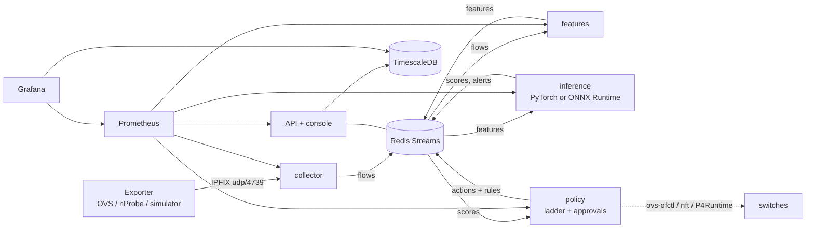

# NetShield-GNN platform guide

This document covers the production-style layer added in version 2.0: how
flow data gets in, how decisions get out, and how the system is secured,
observed and tested. The research results are in
[`results/reports/RESEARCH_RESULTS.md`](../results/reports/RESEARCH_RESULTS.md),
and the protocol behind them is in [`RESEARCH_PROTOCOL.md`](RESEARCH_PROTOCOL.md).

## 1. Architecture



Each stage is one process (`python -m netshield.platform.service <role>`).
Stages scale independently through Redis consumer groups. The same code runs
in one process for tests and the demo, over an in-memory bus.

| Stage | Module | Consumes | Produces |
|---|---|---|---|
| Collector | `platform/pipeline.py::CollectorService` | IPFIX datagrams | `flows` per closed window |
| Features | `FeatureService` | `flows` | `features` (46 node features + graph edges) |
| Inference | `InferenceService` | `features` | `scores`, `alerts` |
| Policy | `PolicyService` | `scores` | `actions` with rendered switch rules |

Feature extraction and scoring call exactly the functions the simulator's
in-loop controller uses. A test replays a simulated attack through IPFIX
encoding, the bus and all four services, and checks that the scores match
offline scoring.

### IPFIX

`platform/ipfix.py` implements RFC 7011 template and data sets. Template 256
carries the standard information elements, plus TCP flag counts and timing
statistics under the RFC 5612 documentation enterprise number. It also
carries `ingressInterface` (IE 10). The collector maps the physical port to
a device, so a spoofed source address is still attributed to the device that
sent it, the same identity the simulator's mitigation keys on.

### Data-plane rules

`mitigation/export.py` renders each action for three targets:

| Target | Rate-limit | Block / isolate |
|---|---|---|
| Open vSwitch (OpenFlow 1.3) | meter + `actions=meter:N,NORMAL` | `priority=40010,in_port=P,actions=drop` |
| Linux gateway (nftables) | `limit rate over N/second ... drop` | `iifname "ethX" drop` |
| P4 switch (P4Runtime) | `ingress_acl` entry, `meter_and_forward` | `ingress_acl` entry, `drop` |

Escalations delete the previous rule first, so each device has at most one
NetShield rule. Rules carry a cookie (`0x4e53....`) so an operator can list
or flush them.

## 2. Security

* **Authentication:** OAuth2 password grant at `POST /api/auth/token`, which
  returns an HS256 JWT. Passwords are stored as PBKDF2-HMAC-SHA256 hashes with
  600,000 iterations and a per-user salt.
* **Authorisation:** three roles. Viewers read everything except the audit
  trail. Operators can also start and stop runs, approve, reject and roll back
  actions, and change the approval mode. Admins can also read the audit trail.
  The rules live in `platform/security.py::ACCESS_RULES` and are enforced by
  one middleware.
* **Human in the loop:** `mitigation.approval_mode` is `auto`, `hybrid` or
  `manual`. In hybrid mode rate limits apply at once, but blocks and
  isolations wait in a queue that operators clear from the console's
  Mitigations page.
* **Audit trail:** every state-changing request, every login and every
  denied request is written to an append-only SQLite table. Each row carries
  a SHA-256 hash chained to the previous row, and `GET /api/audit` reports
  whether the chain is intact.

Enable authentication with `api.auth.enabled: true` or `NETSHIELD_AUTH=1`.
Users come from `config/users.yaml` (hashes only) or, for development:

```bash
NETSHIELD_DEV_USERS="ana:admin:changeme,olga:operator:changeme" NETSHIELD_AUTH=1 python launch.py
```

## 3. Observability

`GET /metrics` exposes Prometheus metrics:

| Metric | Type | Meaning |
|---|---|---|
| `netshield_inference_seconds` | histogram | detector time per window |
| `netshield_windows_scored_total` | counter | windows scored, per detector |
| `netshield_mitigation_actions_total` | counter | actions, by type and origin (auto, approved, rollback) |
| `netshield_pending_approvals` | gauge | actions waiting for an operator |
| `netshield_clean_availability_ratio` | gauge | service level of uninfected devices |
| `netshield_clean_p99_latency_seconds` | gauge | tail latency of uninfected devices |
| `netshield_http_request_seconds` | histogram | API latency per route |
| `netshield_auth_failures_total` | counter | rejected logins, tokens and roles |

`deploy/alerts.yml` defines alert rules: availability below SLO, approvals
waiting, slow inference, and bursts of authentication failures.
`deploy/grafana/` provisions a dashboard.

## 4. Live data and interop

* `WS /ws/live` pushes the live snapshot every second. `GET /api/stream`
  serves the same data as Server-Sent Events. The console uses the WebSocket
  and falls back to polling.
* `GET /api/alerts/export?fmt=stix` returns a STIX 2.1 bundle with sightings,
  ATT&CK attack patterns and observed IPv4 addresses. `fmt=cef` returns
  ArcSight CEF lines for syslog. The ATT&CK mapping is T1498.001 for direct
  floods, T1499.001 for SYN floods and T1499.002 for HTTP and slowloris.

## 5. Serving models with ONNX

`platform/onnx_export.py` exports mean-aggregation GraphSAGE to ONNX. It
first copies the PyG weights into an equivalent pure-PyTorch layer, and
aggregates with a row-normalised adjacency matrix, because ONNX scatter-add
exports drop duplicate updates. It checks equivalence twice:

| Check | Max absolute probability error |
|---|---|
| weight copy vs. trained model | 1.2e-7 |
| ONNX Runtime vs. PyTorch | 1.2e-7 |

On a 259-node batch, ONNX Runtime took 2.8 ms against PyTorch's 44 ms.

## 6. Deployment

```bash
export NETSHIELD_JWT_SECRET=$(openssl rand -hex 32) GRAFANA_ADMIN_PASSWORD=...
docker compose -f deploy/docker-compose.platform.yml up --build
```

This starts the API, the four pipeline services, Redis, TimescaleDB,
Prometheus and Grafana. The TimescaleDB schema, with hypertables,
compression and retention policies, is in `platform/timeseries.py`.

> The compose stack and the Mininet testbed (`testbed/`) were written and
> validated statically on Windows, without Docker or Linux. Both need a Linux
> host to run end to end.

## 7. Quality gates

* `.github/workflows/ci.yml` runs ruff, mypy on the platform layer, tests on
  Python 3.11 and 3.12 with a 75% coverage gate, a benchmark regression check
  and the console type-check and build.
* Property-based tests (Hypothesis) check the IPFIX round trip on random
  flow records.
* `scripts/benchmark.py` divides each timing by a fixed pure-Python
  calibration loop, so `benchmarks/baseline.json` transfers between machines.
  CI fails on a slowdown of more than 25%.

## 8. Simulator performance

Profiling showed that per-packet scalar draws from NumPy's generator
dominated the attack path, at 11 to 19 µs per call. `utils/seeding.py::FastRandom`
serves uniforms from pre-drawn blocks of the same seeded generator.

| 50 s UDP flood, 1.09M events | Wall time (best of 2) |
|---|---|
| NumPy scalar draws | 11.7 s |
| Buffered draws | 7.1 s |

That is 1.6x faster, measured while other jobs loaded the CPU. Results stay
deterministic per seed. Because the random streams changed,
`simulation/runner.py::SIM_VERSION` is folded into every run id, so runs
cached by the old engine are never mixed with new ones.
