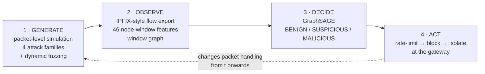
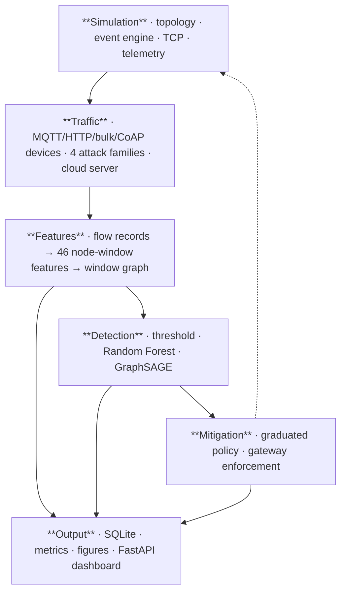
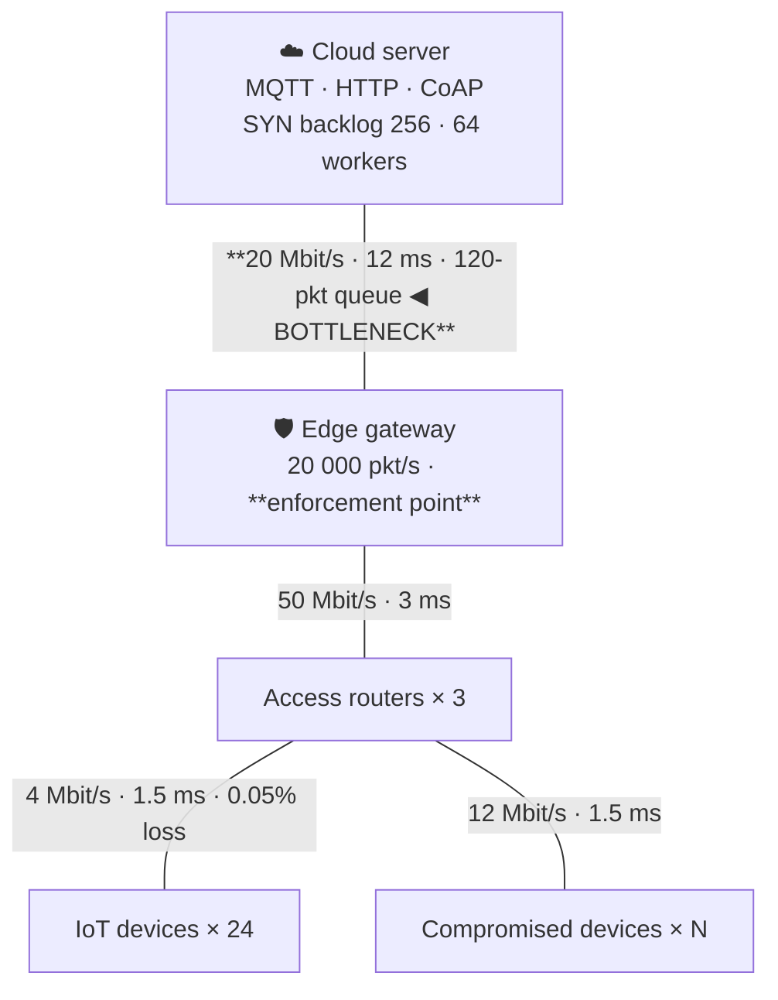
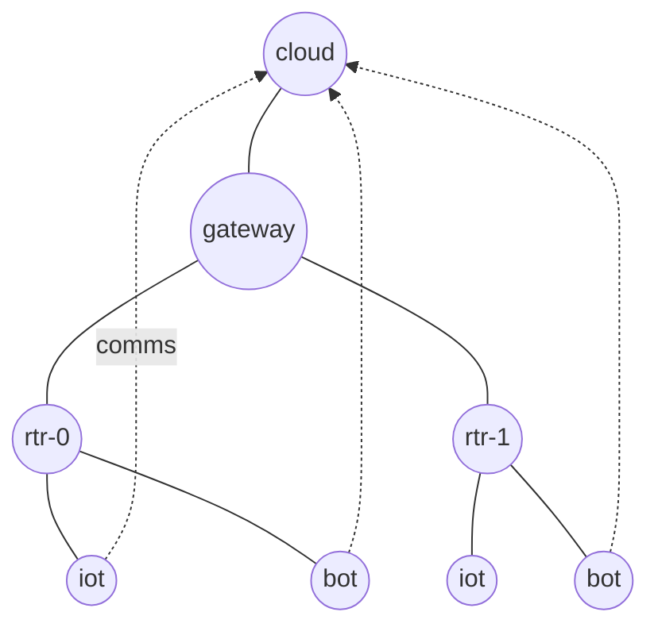

# NetShield-GNN — Presentation Deck

**20 slides · ~15 minutes plus demo · speaker notes under every slide**

> Rendering: this file is standard Markdown with `---` slide separators and
> Mermaid diagrams. It renders as slides in Marp, Reveal.js (`reveal-md`),
> Obsidian Slides, or VS Code's Marp extension. It also reads perfectly well as
> a plain document.

---

## Slide 1 — Title

# NetShield-GNN

### Intelligent DDoS Detection and Automated Mitigation for IoT–Cloud Networks
### Using Dynamic Fuzzing and Graph Neural Networks

**Computer Communication Networks — Engineering Project**

*A packet-level network simulator · four DDoS attack families · a graph neural
network · and a mitigation loop that closes inside the running simulation.*

> **Speaker notes.** Open with the one-sentence version and don't rush it:
> "I built a simulated IoT network, attacked it four different ways, detected
> the attackers with a graph neural network, and then let the system defend
> itself while the attack was still running." Say the last clause slowly — the
> closed loop is what distinguishes this from a machine-learning notebook, and
> it is the thing to plant early. Mention that everything is simulated in memory
> and nothing leaves the machine; get the ethics question retired in the first
> thirty seconds.

---

## Slide 2 — The problem

## An IoT network is a security-hostile shape

- **Many** endpoints — cheap, heterogeneous, rarely patched
- **Weak** — default credentials, no host defences
- Aggregating through **one edge gateway** onto a thin backhaul

### A DDoS attack from inside that fleet is hard to *detect*, not hard to *see*

> A per-device rule sees one camera sending a few hundred packets per second.
> Unremarkable. The attack only exists **in aggregate**.

> **Speaker notes.** The key rhetorical move is separating "see" from "detect".
> Everyone knows a DDoS is loud. The point is that the loudness lives at the
> aggregation point, while the decision has to be made about individual devices.
> If someone asks for a real-world anchor, Mirai in 2016: ~600k compromised IoT
> devices, and the structural conditions that enabled it have not changed.

---

## Slide 3 — Motivation

## Three gaps this project targets

| Gap | Why it matters |
|---|---|
| **Threshold rules are what is deployed** — and they fail predictably | A per-source rate limit cannot catch 36 bots that each stay under the limit |
| **Tabular ML discards the structure that matters** | Scoring devices independently is the wrong inductive bias for a *distributed* attack |
| **Detection without mitigation is half a system** | And evaluating mitigation offline is fiction, not measurement |

> **Speaker notes.** Emphasise that I did *not* strawman the baseline — I
> calibrated its thresholds to the 99th percentile of observed benign traffic,
> which is exactly what a competent operator does, and it still fails. That
> preempts the most obvious criticism of any "our method beats the baseline"
> claim. The third row sets up the closed-loop slide later.

---

## Slide 4 — Existing limitations

## Why current approaches fall short

- **Signature IDS** — an HTTP flood is made of *valid* requests; there is no
  signature to match
- **Entropy / statistical detectors** — fire on flash crowds; high false-positive
  rate
- **Per-node thresholds** — structurally blind to distribution
- **Flow-based tabular ML** — strong, but assumes samples are independent

### The evidence is *relational*. So the model should be too.

> **Speaker notes.** This is the slide that motivates the architecture choice, so
> land the last line. If asked "why not just sum traffic at the gateway?" — you
> can, and that tells you *an* attack is happening, but not *which* devices to
> block. The system has to attribute, not just alarm.

---

## Slide 5 — Proposed solution

## NetShield-GNN — a closed loop in four stages



**The dashed arrow is the contribution.** Mitigation runs *inside* the
simulation, so recovery is measured, not asserted.

> **Speaker notes.** Walk the four boxes in about twenty seconds each, then stop
> on the dashed arrow and explain what it buys: because the enforcement point is
> consulted for every packet arriving at the gateway, a rule installed at t = 40 s
> physically changes the run from t = 40 s. If mitigation were simulated
> afterwards, "recovery time" would be arithmetic. Here it is a measurement.

---

## Slide 6 — Architecture

## Layered, and each layer testable on its own



~11,000 lines of typed, documented Python · 30 modules · 5 test suites

> **Speaker notes.** Don't read the boxes aloud. The point of this slide is that
> the layers are decoupled: the simulator has no idea a GNN exists, the feature
> layer has no idea which model consumes it, and all three detectors sit behind
> one interface. That is what makes the comparison a controlled experiment
> rather than three separate pipelines.

---

## Slide 7 — Network topology

## Four tiers, one bottleneck



**Genuine networking, not a traffic generator:** store-and-forward switching ·
finite drop-tail queues · $D_{tx} = 8S/B$ · per-node processing servers ·
Reno TCP (slow start, AIMD, RTO)

> **Speaker notes.** This is the slide to defend the simulator's credibility on.
> Two facts to have ready. First: the configured one-way path delay is
> 1.5 + 3 + 12 = 16.5 ms, and the measured benign latency is ≈17 ms — the
> difference is serialisation. Second: latency, loss and throughput are never
> configured anywhere; they emerge from the queueing model. There is a unit test
> for both claims.

---

## Slide 8 — DDoS scenarios

## Four families, each exhausting a different resource

| Family | Exhausts | Measured signature |
|---|---|---|
| **UDP flood** | Link bandwidth | 99.9% uplink use · 44.7% clean loss · latency 20 → 37 ms |
| **SYN flood** | Connection-table *state* | **159,722 of 162,160 SYNs rejected** · backlog pegged at 256 · **only ~26% link use** |
| **HTTP flood** | Server worker pool | Every request individually valid |
| **Mixed** | All of the above | Per-bot family assignment |

Plus **burst shaping** (on/off pulsing) and **source spoofing** with accounted
backscatter.

> **Speaker notes.** The SYN-flood row is the single best evidence that the
> network model is real. It denies service using a *quarter* of the bandwidth the
> UDP flood uses, because what it exhausts is a state table, not a link. A
> statistical traffic generator could not produce that asymmetry — you need an
> actual finite half-open connection table with a timeout, which is what
> `traffic/server.py` implements. There is a test asserting the SYN flood uses
> less bandwidth than the UDP flood.

---

## Slide 9 — Dynamic fuzzing

## Fuzzing the *detector*, not the parser

The subject under test is the detector; the input is the attack's parameter
vector — rate, packet size, burst duty cycle, ports, botnet size, timing,
spoofing.

| Strategy | What it does |
|---|---|
| `grid` | Exhaustive sweep → 1-D robustness curves |
| `random` | Combinations no human would write |
| `mutation` | Seeded random walk around a baseline |
| **`adaptive`** | **Greedy search that minimises detector recall** — coverage-guided fuzzing with "detector weakness" as the coverage signal |

### It found a real bug

A random pulsing configuration **livelocked the simulator**: floating-point
`floor` at an exact burst-cycle boundary made "next burst start" evaluate to
*exactly now*, so the event loop rescheduled at the same timestamp forever.

> **Speaker notes.** Tell the bug story properly — it is the most persuasive
> thing on this slide and examiners like it. The wall-clock budget I had added to
> the engine reported a stall at "simulated t = 42.0 s", and a suspiciously round
> number is a clue. The fix is an epsilon inside the floor plus a hard
> forward-progress guarantee, and there is now a regression test that probes
> exact cycle boundaries. Then make the general point: no hand-written scenario
> would have hit that, which is precisely the argument for fuzzing.

---

## Slide 10 — Graph representation

## One graph per 5-second window

**Nodes** — devices, bots, routers, gateway, cloud · each carrying 46 features

**Edges** — two families:
- `physical` — the topology → carries the **aggregation hierarchy**
- `communication` — observed `src → dst`, weighted $\log(1+\text{packets})$



**Two hops is exactly the right receptive field:** hop 1 reaches your router,
hop 2 reaches the gateway and — via the cloud — every other talker in the window.

> **Speaker notes.** If you are asked "why two layers?", the answer is on this
> slide and it is a design argument, not a hyperparameter: on a four-tier tree,
> two hops reach everything that matters, and a third would add over-smoothing
> without reaching anything new. Also flag that routers and the gateway are
> first-class graph nodes with their own features — attributed from the flows
> they forward — because without them there would be no aggregation point for
> the model to reason about.

---

## Slide 11 — GraphSAGE

## Why GraphSAGE specifically

$$h_v^{(k)} = \sigma\Big(W_{\text{self}}\,h_v^{(k-1)} + W_{\text{nbr}}\cdot\mathrm{MEAN}_{u\in\mathcal{N}(v)}\,h_u^{(k-1)}\Big)$$

- **Inductive** — learns an aggregator *function*, not a per-node embedding
- Therefore transfers to graphs with node counts it has never seen
- **This is not optional here:** experiments vary the fleet from 24 to 60 nodes,
  and the held-out run has an attacker count absent from training

| | |
|---|---|
| Layers | 2 × `SAGEConv`, mean aggregation |
| Hidden width | 64 · LayerNorm · dropout 0.3 |
| Parameters | **14,659** |
| Loss | Inverse-frequency weighted cross-entropy |
| Selection | Early stopping on validation macro-F1 |

> **Speaker notes.** The inductive point is the strongest technical
> justification, so make it concrete: a transductive model like a vanilla GCN
> learns node-specific parameters and literally could not be evaluated on
> Experiment 7, which has a device count it never saw. Also mention the model is
> tiny — 14,659 parameters — which matters for an edge-deployment story and
> preempts "isn't a GNN too heavy for a gateway?".

---

## Slide 12 — Detection pipeline

## Every 5 seconds, for every node

```
flow records  →  46 features  →  window graph  →  GraphSAGE  →  P(hostile)
```

**Three classes, because a bot is not equally malicious in every window:**

$$\text{severity} = \frac{\text{attack packets}}{\text{total packets}} \times \frac{\text{active attack seconds}}{\text{window length}}$$

**Zero label leakage.** Features come only from what a gateway can observe.
`assert_no_leakage()` runs inside the scaler, so no model can be fitted on a
ground-truth column — enforced by a test, not a comment.

> **Speaker notes.** The leakage guard is worth ten seconds of emphasis: the
> simulator's `app` tag literally contains the string `attack_udp`, so leaking
> it would give a perfect classifier and a worthless result. Making that an
> assertion inside `FeatureScaler.fit` means it cannot be forgotten. On the
> three-class point: compromised devices keep running their legitimate
> application — like a real infected camera still streaming video — which is what
> makes the middle band meaningful rather than decorative.

---

## Slide 13 — Mitigation

## A graduated, reversible response ladder

| Confidence | Action | Why graduated |
|---|---|---|
| $p \ge 0.60$ | Token-bucket rate limit | Blocking a legitimate sensor is a **silent outage** |
| $p \ge 0.85$ | Simulated source block | Letting one bot through costs a fraction of a link |
| $p \ge 0.95$ **sustained** | Gateway port isolation | The destructive action needs **persistence**, not one lucky window |
| clean windows | Automatic release | The system heals itself |

### Enforcement keys on **ingress port identity**, never on source IP

A SYN flood forges its address — an IP-keyed ACL would fail to stop the bot *and*
blackhole innocent third parties.

> **Speaker notes.** The asymmetric-cost argument is the reason for the whole
> ladder, so state it explicitly. The ingress-identity point is a genuinely good
> networking observation and examiners tend to like it: the gateway knows which
> physical port a frame arrived on, and that is something the attacker cannot
> forge from its side. There is a test that forges a source address on a blocked
> node's packet and asserts it is still dropped.

---

## Slide 14 — Dashboard

## Live console — `./run.sh dashboard`

- Live **network topology**, nodes coloured by predicted class, ringed if
  ground-truth compromised
- KPI tiles: devices · packet rate · throughput · latency · loss · uplink use ·
  suspicious · malicious · mitigated · GNN confidence
- Time series: throughput vs offered load · latency and loss · **detector
  confidence with the trigger line**
- Alert and mitigation logs, updating as the simulation runs
- Auto-generated OpenAPI docs at `/docs`

> **Speaker notes.** If you are demoing live, this slide is just a pointer —
> switch to the browser instead of talking over it. Worth saying once: the API
> has **no host, port or target parameter anywhere**; the only state-changing
> endpoints start and stop an in-process simulation, so it cannot be repurposed
> to attack anything.

---

## Slide 15 — Experiments

## Eight scenarios

| # | Scenario | Configuration |
|---|---|---|
| 1 | Normal | 24 IoT, no attack — baseline envelope |
| 2 | UDP flood | 4 bots @ 1400 pkt/s |
| 3 | SYN flood | 3 bots @ 1800 pkt/s, spoofed |
| 4 | HTTP flood | 4 bots @ 320 req/s |
| 5 | **Distributed** | **36 bots @ 22 pkt/s**, CoAP-shaped, 2 Mbit/s backhaul |
| 6 | Fuzzed | Pulsing 2.5 s on / 3.5 s off |
| 7 | Unseen | **Held out** — parameters outside training ranges |
| 8 | **Mitigation** | Closed loop: detect → mitigate → recover |

**Corpus:** 12,863 node-windows · 28 runs · split **by run**, never by row

> **Speaker notes.** Spend your time on Experiment 5 — it is the scientifically
> important one. Thirty-six bots each sending ~22 packets/second of CoAP-shaped
> UDP: same port, same packet size, same steady cadence as a legitimate sensor.
> No single device is anomalous. The backhaul is a 2 Mbit/s cellular link, so the
> aggregate genuinely saturates it. Also flag the grouped split: two windows of
> the same simulation share device identities and RNG streams, so a row split
> would leak and inflate every score.

---

## Slide 16 — Results: detection

## Test split — 3,331 node-windows

| Detector | Accuracy | Macro-F1 | Attack recall | **FPR** |
|---|---:|---:|---:|---:|
| Threshold (calibrated) | 0.725 | 0.407 | 0.473 | **22.3%** |
| Random Forest | 0.991 | 0.862 | 1.000 | **0.14%** |
| **GraphSAGE** | **0.993** | **0.867** | 1.000 | **0.44%** |

### On the stealthy distributed attack (Exp 5)

> **The threshold rule catches 18% of the bots** — at a 22% false-alarm rate.
> Both learned detectors catch **100%**.

**Detection latency: 5.0 s** — exactly one feature window, which is the floor for
a windowed design.

> **Speaker notes.** Lead with the false-positive rate, not the accuracy. On this
> fleet, 288 node-windows per minute means a 22% FPR is an alert every couple of
> seconds — unusable regardless of recall. Then the Experiment 5 line, which is
> the predicted structural failure of per-node rules and the reason the project
> exists. On latency, be precise and unembarrassed: 5 seconds *is* one window, a
> windowed detector cannot decide sooner, and shortening the window trades
> latency against statistical stability.

---

## Slide 17 — Results: mitigation

## Experiment 8 — measured, not asserted

**Six bots at 1,500 pkt/s. Attack runs t = 35 s → 105 s. Mitigation from t = 40 s.**

| Phase (disjoint) | Uplink use | Clean loss | Clean latency |
|---|---:|---:|---:|
| Normal | 1.7% | 0.07% | 20.2 ms |
| **Under attack, unmitigated** | **99.9%** | **44.7%** | 37.4 ms |
| **Mitigated — attack still running** | **1.3%** | **0.06%** | 19.8 ms |

| | |
|---|---|
| Bots stopped | **6 / 6** |
| Legitimate devices affected | **0** |
| Attack packets dropped at the gateway | 585,997 |
| **Recovery time** | **5.0 s** |

> **Speaker notes.** The crucial sentence: rows two and three carry **the same
> offered attack load** — 9,000 packets/second of flood traffic is still being
> emitted in row three — so the difference isolates the effect of the defence.
> Also explain "clean loss": isolating a bot also cuts off that bot's own
> legitimate telemetry, so I measure loss for *never-compromised* devices
> separately. Counting the bots' own traffic as collateral damage would misstate
> the result, and I would rather define the metric carefully than flatter it.

---

## Slide 18 — Comparison and honest nuance

## Where the graph actually helps

| Scenario | Threshold | Random Forest | GraphSAGE |
|---|---:|---:|---:|
| Hand-written scenarios (macro-F1) | 0.28 – 0.49 | **1.000** | 0.92 – 1.000 |
| **Fuzzer-generated parameters** (macro-F1) | 0.490 | 0.803 | **0.850** |
| **Held-out run — bots found** | 7/7, but **21 false alarms** | **5 / 7** | **7 / 7, zero false alarms** |

- Overall, GraphSAGE beats the forest by **0.006** macro-F1 — real but small
- On **fuzzed** parameters the gap is **0.047**; on the **held-out run** it is
  decisive — 7/7 bots and no false alarms, versus 5/7 for the forest
- GraphSAGE has **perfect `MALICIOUS` recall (368/368)**; the forest demotes 25
  malicious windows to "suspicious"

### The strong claim: *learned* detection ≫ static rules.
### The narrower claim: *graphs* > tabular — holds on generalisation, and I say so.

> **Speaker notes.** Do not skip this slide, and do not apologise for it. An
> examiner who spots that the forest nearly matches the GNN and finds it
> *addressed* on a dedicated slide will trust everything else more. Make the
> operational point too: for a system that automatically blocks devices, missing
> a bot is worse than over-escalating a suspicious one, and that is exactly the
> error profile GraphSAGE has.

---

## Slide 19 — Limitations

## Stated before you ask

1. **NS-3 was not used** for these results — no C++ toolchain on the host. The
   NS-3 model ships in the repo; every artefact is stamped *"Python
   discrete-event emulation"* by a real capability probe.
2. **Ground truth is synthetic** — exact because I generated it, and therefore
   possibly optimistic versus messy production traffic.
3. **The graph advantage is modest** on hand-written scenarios (Slide 18).
4. **`SUSPICIOUS` is small and hard** — 23 test samples, F1 ≈ 0.63.
5. **TCP is simplified** — no fast retransmit, SACK or receiver-window flow control.
6. **No temporal modelling** across windows.
7. **The adversary does not adapt** to the defence.

> **Speaker notes.** Limitation 1 is the one to volunteer first and clearly. The
> point to land is that the *system* prevents misrepresentation: `resolve_engine`
> probes for `$NS3_DIR/ns3`, the binary on `PATH` and the Python bindings, and
> stamps the result into `run.json`, the dataset's `engine` column, every figure
> caption and the report header. With `engine: ns3` a missing install is a hard
> error, never a silent fallback. Owning that up front is worth more than any
> result on the slide before.

---

## Slide 20 — Future work and conclusion

## Next steps

| Priority | Work |
|---|---|
| High | Hundreds of bots at per-node rates strictly *inside* the legitimate distribution |
| High | Temporal modelling — GraphSAGE + GRU across windows |
| High | Validate on a public capture (CIC-DDoS2019 / Bot-IoT) |
| Medium | Close the adversarial loop; build and cross-validate the NS-3 model |

## Conclusion

- A **real network model** — emergent latency, loss and throughput
- A **calibrated baseline that fails as theory predicts** — 18% recall on a
  stealthy botnet
- **99.3% accuracy, 100% attack recall, 0.44% FPR** from a 14,659-parameter GNN
- A **closed loop**: 99.9% → 1.3% uplink use and 44.7% → 0.06% loss, **while the
  attack was still running**, 6/6 bots stopped, **zero** collateral damage
- **Fuzzing earned its place twice** — it supplied the diversity where the graph
  model wins, and it found a real livelock bug in my own simulator

### `./run.sh demo` — two minutes, live

> **Speaker notes.** Close on the closed loop and then run the demo if there is
> time; the terminal narration shows normal traffic, the attack arriving, the
> detection firing, rules being installed, and loss recovering — all in about two
> minutes. Final line to leave in the room: *"the recovery numbers are
> measurements, not claims, because the defence ran inside the simulation."*

---

## Appendix — 3-minute lightning version

| Time | Slides | Say |
|---|---|---|
| 0:00–0:30 | 1–2 | IoT DDoS is hard to detect because it is *distributed*; per-device rules are structurally blind |
| 0:30–1:15 | 7–8 | Real packet-level simulator; four attack families; SYN flood denies service at a quarter of the bandwidth |
| 1:15–2:00 | 10–11 | One graph per 5-second window; two hops reach the aggregation point; GraphSAGE is inductive, so it transfers to unseen fleet sizes |
| 2:00–2:40 | 16–17 | Threshold catches 18% of a stealthy botnet; GNN catches 100% at 0.44% FPR; closed loop takes uplink use from 99.9% → 1.3% *while the attack runs*, 6/6 bots, zero collateral damage |
| 2:40–3:00 | 19 | Volunteer the NS-3 limitation and the provenance labelling; close on "measurements, not claims" |
