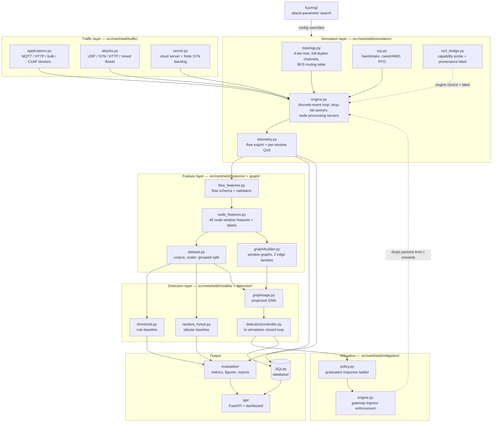
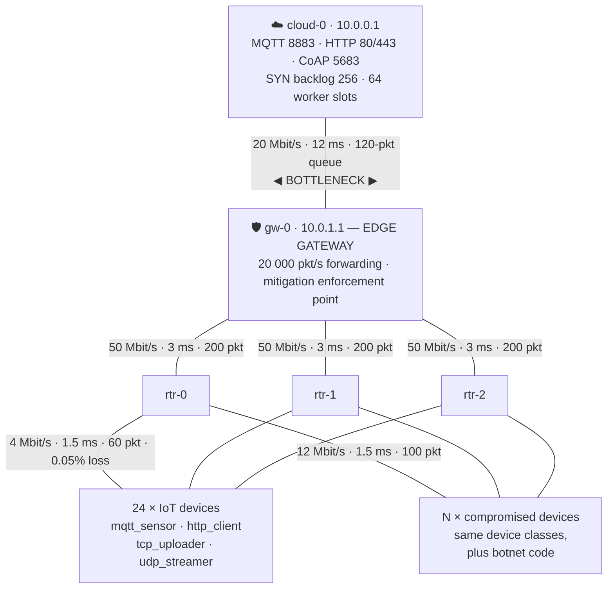
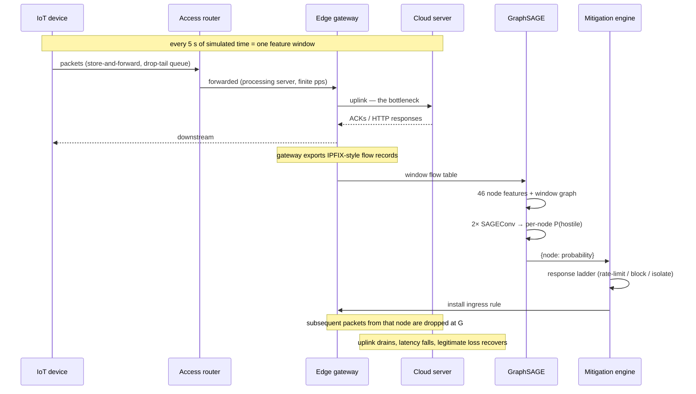

# NetShield-GNN — System Architecture

## 1. One-paragraph summary

NetShield-GNN is a closed-loop DDoS defence system for IoT–cloud networks. A
discrete-event simulator instantiates a four-tier network (IoT devices → access
routers → edge gateway → cloud server), runs realistic IoT application traffic
and simulated DDoS attacks over it, and exports IPFIX-style flow records. Those
records are turned into a per-node, per-time-window feature matrix and a
communication graph; a GraphSAGE graph neural network classifies every node in
every window as `BENIGN`, `SUSPICIOUS` or `MALICIOUS`; and a policy engine
installs rate-limit, block or isolation rules **at the gateway inside the running
simulation**, so recovery is a measured consequence rather than a claim.

---

## 2. Component diagram



The dashed arrow from the mitigation enforcer back into the engine is the
architectural heart of the project: it is what makes this a control loop instead
of an offline classifier.

---

## 3. Network topology



Because the physical layout is a **tree**, the gateway uplink is the only path
from any device to the cloud. That is not a modelling shortcut — it is the
defining property of an edge deployment, and it is why a distributed flood
converges into a single choke point that a *relational* detector can see.

Every parameter above comes from `config/network.yaml` and can be changed
without touching code.

---

## 4. Data flow, end to end



---

## 5. Module reference

| Module | Responsibility | Key types |
|---|---|---|
| `utils/config.py` | Layered YAML config: deep-merge, dotted access, validation | `Config`, `ConfigError` |
| `utils/seeding.py` | Deterministic RNG derivation for every subsystem | `seed_everything`, `rng_for` |
| `simulation/packet.py` | Packet model, wire-size accounting, TCP flags | `Packet`, `Protocol`, `TCPFlag` |
| `simulation/topology.py` | Node/link construction, BFS routing, the baseline tree | `Topology`, `NetNode`, `Channel` |
| `simulation/topologies.py` | Six further topology families + structural validation | `build_family_topology`, `validate_topology` |
| `simulation/engine.py` | Event loop, queueing, forwarding, enforcement hook | `SimulationEngine`, `PacketFilter` |
| `simulation/tcp.py` | Handshake, cwnd/AIMD, RTO, demultiplexing | `TcpConnection`, `TcpDispatcher` |
| `simulation/telemetry.py` | Flow export + per-window QoS measurement | `FlowRecord`, `WindowMetrics` |
| `simulation/ns3_bridge.py` | NS-3 probe (native + WSL), invocation, provenance | `NS3Availability`, `resolve_engine` |
| `simulation/ns3_runner.py` | Config — NS-3 params, result assembly, fidelity reporting | `execute`, `ns3_warnings` |
| `simulation/runner.py` | Wiring, run identity, artefact save/load | `SimulationResult` |
| `traffic/applications.py` | Four IoT device classes with reconnect logic | `MqttSensorApp`, … |
| `traffic/attacks.py` | Six attack families, rate waveforms, per-bot jitter, spoofing | `AttackProfile`, `Attacker` |
| `traffic/server.py` | Cloud server, SYN backlog, worker pool, connection table | `CloudServer` |
| `features/node_features.py` | The 46 features + severity labelling + leakage guard | `build_node_window_features` |
| `features/dataset.py` | Corpus assembly, scaler, grouped split | `FeatureScaler`, `DatasetSplit` |
| `graph/builder.py` | Window graphs, physical + communication edges | `WindowGraph` |
| `models/*.py` | Three detectors behind one interface | `Detector` |
| `detection/controller.py` | In-simulation detection + mitigation loop | `DetectionController` |
| `mitigation/policy.py` | Confidence → action ladder | `PolicyConfig`, `ActionType` |
| `mitigation/engine.py` | Token buckets, blocklists, action log | `MitigationEnforcer` |
| `fuzzing/*.py` | Attack-parameter space and search strategies | `FuzzEngine`, `FuzzCase` |
| `evaluation/*.py` | Metrics, figures, Markdown reports | `DetectionMetrics` |
| `database/*.py` | SQLite schema and repository | `NetShieldDB` |
| `api/*.py` | REST API, live session, dashboard | `SimulationSession` |

---

## 6. Design decisions and their justification

### 6.1 Why a custom discrete-event engine *as well as* NS-3

Both engines are real and both run. ns-3.44 is built from source and
`ns3/simulations/netshield-topology.cc` is compiled into it and executed; see
`ns3/README.md`. The custom engine is nevertheless the **reference**
implementation, for two reasons.

First, coverage: all seven topology families, all six attack families, the rate
waveforms and the closed mitigation loop exist in the Python engine, and the C++
model implements a subset of them. Second, and more importantly, **a corpus must
come from one simulator**. If engine selection switched per scenario, the
training set would be a mixture of two simulators while the closed-loop
evaluation stayed on one — a train/test mismatch that would be invisible in the
results. So `simulation.engine: auto` resolves to the Python engine even when
NS-3 is installed, and NS-3 is opt-in, used to cross-validate the physics
(a configured 16.5 ms path measures ~17 ms here and 17.32 ms in NS-3).

The engine in `simulation/engine.py` is therefore a genuine discrete-event
simulator, not a statistical traffic generator:

- a global event queue advances time in strictly increasing order;
- every packet is **store-and-forward** switched hop by hop;
- each directed channel is a single-server queue with a finite drop-tail buffer,
  a serialisation delay of `size × 8 / bandwidth` and a propagation delay;
- each router/gateway/server additionally has a **processing server** capped at
  `forwarding_pps`, giving a second, packet-rate-bound bottleneck.

Latency, packet loss and throughput are consequently **emergent** — computed
from timestamps and queue behaviour, never configured. A measured mean latency
of ≈17 ms for a benign run is the sum of the configured one-way delays
(1.5 + 3 + 12 = 16.5 ms) plus serialisation and queueing, which is exactly what
`tests/test_simulation.py::test_latency_matches_the_physical_path_delay` asserts.

### 6.2 Why flow records rather than a packet trace

A single volumetric run generates over a million packets. Storing one row per
packet is neither tractable nor realistic: production gateways export **flow
records** (NetFlow/IPFIX) — per-window, per-5-tuple aggregates. `telemetry.py`
does the same, accumulating second-order statistics (size variance, inter-arrival
jitter) with running sums so each record stays O(1) in memory.

### 6.3 Why compromised nodes still run their legitimate application

A real Mirai-infected camera keeps streaming video while it floods. Modelling
attackers as pure flood sources would make the label a trivial function of
"is this node transmitting at all". Giving them a real device class means their
traffic is a *mixture*, which is what produces a genuine three-class problem and
a meaningful `SUSPICIOUS` middle band.

### 6.4 Why the label combines composition **and** temporal coverage

```
attack_ratio = attack_packets / total_packets      (what it sent)
duty         = active_attack_seconds / window_s     (how long it attacked)
severity     = attack_ratio × duty
```

Both terms are required. A node that floods at full rate for half a second of a
five-second window is genuinely *suspicious*, not fully malicious; a pulsing
attacker legitimately sits in the middle band. Using composition alone would
collapse the problem back to two classes.

### 6.5 Why all three detectors receive identical inputs

The threshold rule, the Random Forest and GraphSAGE consume the same 46-feature
node-window rows, the same grouped split and the same feature scaler. The only
thing GraphSAGE has that the others do not is **the graph**. Any performance
difference is therefore attributable to structure rather than to feature
engineering — which is the claim the project actually needs to defend.

### 6.6 Why splits are grouped by run

Two windows from the same simulation share device identities, RNG streams and
attack parameters. Splitting by row would leak. `split_by_run` allocates whole
runs, and `exp7_unseen` is excluded from the corpus entirely so generalisation
is measured on parameters the models were never fitted on.

### 6.7 Why mitigation keys on ingress identity, not source IP

A SYN flood spoofs its source address. An IP-keyed ACL would both fail to stop
the bot and blackhole innocent third parties whose addresses were forged. The
gateway knows which physical port a frame arrived on; that is the identity the
enforcer uses, and
`tests/test_mitigation_and_api.py::test_enforcement_keys_on_node_not_spoofable_ip`
locks the behaviour in.

### 6.8 Why the mitigation response is graduated

The cost of error is asymmetric. Blocking a legitimate temperature sensor is a
silent outage nobody notices until the data is missing; letting one bot through
costs a fraction of a link. So the ladder escalates with **confidence** and with
**persistence**, and the most destructive action (isolation) requires repeated
high-confidence detections rather than one lucky window.

---

## 7. Safety architecture

| Guarantee | How it is enforced |
|---|---|
| No packet leaves the host | No module imports `socket`, `scapy` or any raw-socket API. Attack "packets" are Python objects pushed onto an in-memory heap. |
| Attacks target only simulated nodes | `Attacker.__init__` raises `AttackSafetyError` unless the target is a node in the in-process topology. |
| Spoofed addresses cannot alias a real device | `spoofed_ip_pool` draws from `10.66.0.0/16`, which the topology builder never assigns; a test asserts the disjointness. |
| The API cannot be used to attack anything | The only state-changing endpoints start/stop an in-process simulation. There is no host, port or target parameter anywhere in the API surface. |
| Runaway configurations terminate | Per-run packet cap and wall-clock budget; an exhausted budget marks the run truncated and says so rather than hanging. |

---

## 8. Extension points

| To add… | Change |
|---|---|
| A new attack family | Subclass `Attacker`, register it in `build_attack_campaign`, add its name to `VALID_ATTACK_TYPES`. |
| A new device class | Subclass `Application`, add it to `APPLICATION_CLASSES` and to `traffic.device_mix`. |
| A new detector | Subclass `Detector` (five methods), register it in `DETECTOR_CLASSES`. The evaluation harness picks it up automatically. |
| A new feature | Append to `NODE_FEATURE_COLUMNS` and compute it in `_egress_aggregate`/`_ingress_aggregate`. The leakage guard and the scaler follow automatically. |
| A different topology | Edit `config/network.yaml`. No code change is needed for tier sizes, link rates, delays or queue depths. |
| A new mitigation action | Add to `ActionType`, give it a drop reason in `DROP_REASON`, handle it in `MitigationEnforcer.inspect`. |
