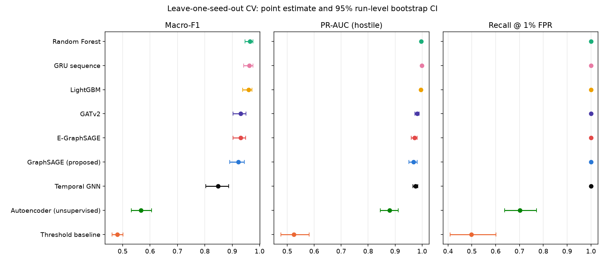
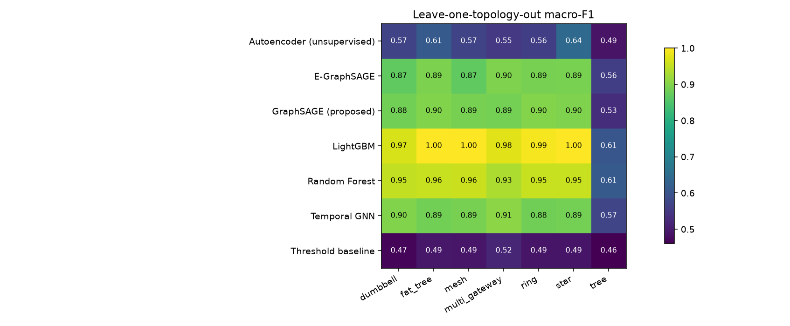
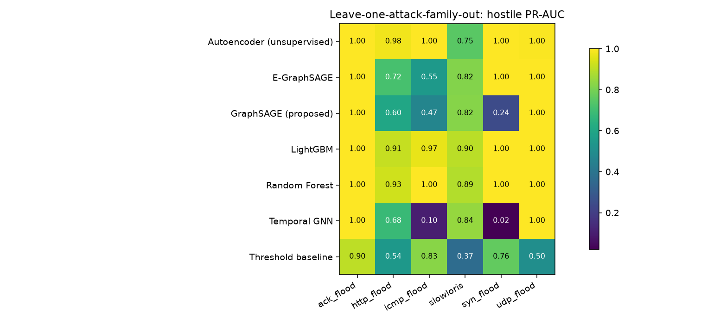
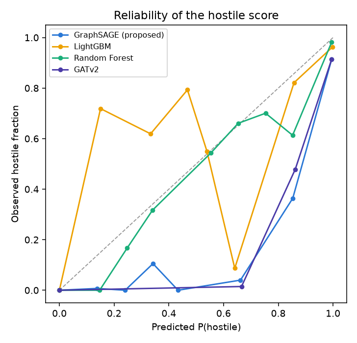

# NetShield-GNN research protocol results

Auto-generated by `scripts/research_protocol.py analyse`. Every number is recomputed from the saved out-of-fold predictions under `results/research/predictions`.

## Corpus

- Runs: 275 (212 attack/benign, 63 benign-stress)
- Node-window rows: 133,269
- Topologies: dumbbell, fat_tree, mesh, multi_gateway, ring, star, tree
- Scenarios: exp15_icmp_flood, exp16_ack_flood, exp17_slowloris, exp18_ramp, exp19_multivector, exp1_normal, exp20_flash_crowd, exp21_firmware_storm, exp22_reboot_storm, exp2_udp_flood, exp3_syn_flood, exp4_http_flood, exp5_distributed, exp6_fuzzed
- Seeds per cell: 4

## 1. Leave-one-seed-out cross-validation

Pooled out-of-fold predictions over 212 runs and 108,494 node-windows. Brackets are 95% confidence intervals from a cluster bootstrap that resamples whole runs.

| Detector | Macro-F1 | MCC | PR-AUC (hostile) | Recall @ 1% FPR | FPR | ECE | F1 suspicious |
|---|---:|---:|---:|---:|---:|---:|---:|
| Random Forest | 0.9648 [0.9468, 0.9762] | 0.9707 [0.9610, 0.9800] | 0.9972 [0.9950, 0.9986] | 0.9999 [0.9996, 1.0000] | 0.0038 [0.0025, 0.0051] | 0.0026 [0.0018, 0.0034] | 0.9213 |
| GRU sequence | 0.9622 [0.9423, 0.9758] | 0.9835 [0.9777, 0.9888] | 0.9995 [0.9992, 0.9998] | 1.0000 [1.0000, 1.0000] | 0.0018 [0.0012, 0.0025] | 0.0018 [0.0013, 0.0024] | 0.8999 |
| LightGBM | 0.9595 [0.9384, 0.9724] | 0.9684 [0.9576, 0.9787] | 0.9958 [0.9931, 0.9979] | 0.9996 [0.9991, 1.0000] | 0.0032 [0.0021, 0.0043] | 0.0036 [0.0024, 0.0048] | 0.9065 |
| GATv2 | 0.9315 [0.9028, 0.9502] | 0.9467 [0.9354, 0.9582] | 0.9821 [0.9731, 0.9892] | 0.9996 [0.9988, 1.0000] | 0.0072 [0.0055, 0.0088] | 0.0067 [0.0051, 0.0083] | 0.8458 |
| E-GraphSAGE | 0.9306 [0.9035, 0.9497] | 0.9450 [0.9348, 0.9554] | 0.9715 [0.9598, 0.9814] | 1.0000 [0.9994, 1.0000] | 0.0076 [0.0060, 0.0092] | 0.0073 [0.0056, 0.0089] | 0.8442 |
| GraphSAGE (proposed) | 0.9225 [0.8912, 0.9439] | 0.9442 [0.9326, 0.9565] | 0.9688 [0.9512, 0.9819] | 0.9997 [0.9988, 1.0000] | 0.0075 [0.0057, 0.0091] | 0.0078 [0.0060, 0.0096] | 0.8197 |
| Temporal GNN | 0.8484 [0.8035, 0.8878] | 0.9295 [0.9128, 0.9450] | 0.9760 [0.9661, 0.9847] | 1.0000 [0.9997, 1.0000] | 0.0081 [0.0063, 0.0098] | 0.0080 [0.0062, 0.0097] | 0.6113 |
| Autoencoder (unsupervised) | 0.5671 [0.5318, 0.6058] | 0.6297 [0.5688, 0.6910] | 0.8790 [0.8446, 0.9115] | 0.7020 [0.6371, 0.7717] | 0.0114 [0.0080, 0.0150] | 0.0210 [0.0166, 0.0260] | 0.0565 |
| Threshold baseline | 0.4806 [0.4614, 0.5007] | 0.3053 [0.2716, 0.3413] | 0.5241 [0.4770, 0.5807] | 0.4973 [0.4083, 0.6015] | 0.2166 [0.2128, 0.2207] | 0.2738 [0.2681, 0.2794] | 0.0155 |

### Paired comparisons against GraphSAGE

Difference = GraphSAGE minus the other detector, on the same resampled runs. p-values are Holm-corrected across every comparison in this table.

| Comparison | Metric | Difference [95% CI] | p (Holm) | Significant |
|---|---:|---:|---:|---:|
| Threshold baseline | Macro-F1 | +0.4420 [+0.4059, +0.4725] | 0.0000 | yes |
| Threshold baseline | PR-AUC (hostile) | +0.4447 [+0.3891, +0.4963] | 0.0000 | yes |
| Autoencoder (unsupervised) | Macro-F1 | +0.3554 [+0.3139, +0.3961] | 0.0000 | yes |
| Autoencoder (unsupervised) | PR-AUC (hostile) | +0.0898 [+0.0649, +0.1161] | 0.0000 | yes |
| Random Forest | Macro-F1 | -0.0422 [-0.0580, -0.0299] | 0.0000 | yes |
| Random Forest | PR-AUC (hostile) | -0.0284 [-0.0440, -0.0155] | 0.0000 | yes |
| LightGBM | Macro-F1 | -0.0370 [-0.0493, -0.0268] | 0.0000 | yes |
| LightGBM | PR-AUC (hostile) | -0.0269 [-0.0426, -0.0143] | 0.0000 | yes |
| GRU sequence | Macro-F1 | -0.0397 [-0.0530, -0.0286] | 0.0000 | yes |
| GRU sequence | PR-AUC (hostile) | -0.0307 [-0.0475, -0.0169] | 0.0000 | yes |
| GATv2 | Macro-F1 | -0.0090 [-0.0190, -0.0006] | 0.1040 | no |
| GATv2 | PR-AUC (hostile) | -0.0133 [-0.0240, -0.0052] | 0.0000 | yes |
| E-GraphSAGE | Macro-F1 | -0.0080 [-0.0162, -0.0007] | 0.1040 | no |
| E-GraphSAGE | PR-AUC (hostile) | -0.0027 [-0.0138, +0.0069] | 0.6420 | no |
| Temporal GNN | Macro-F1 | +0.0742 [+0.0170, +0.1342] | 0.0000 | yes |
| Temporal GNN | PR-AUC (hostile) | -0.0072 [-0.0188, +0.0022] | 0.3000 | no |

### Across scenario-topology cells

Wilcoxon signed-rank test on per-cell macro-F1, GraphSAGE against each detector, Holm-corrected.

| Other | Won/Tied/Lost | Median diff | p (Holm) |
|---|---:|---:|---:|
| Threshold baseline | 53/0/0 | +0.1187 | 0.0000 |
| Autoencoder (unsupervised) | 52/1/0 | +0.0156 | 0.0000 |
| Random Forest | 0/37/16 | +0.0000 | 0.0046 |
| LightGBM | 1/36/16 | +0.0000 | 0.0058 |
| GRU sequence | 0/37/16 | +0.0000 | 0.0046 |
| GATv2 | 4/40/9 | +0.0000 | 0.4099 |
| E-GraphSAGE | 4/40/9 | +0.0000 | 0.4099 |
| Temporal GNN | 14/37/2 | +0.0000 | 0.0282 |

### Bots found and innocent devices flagged, per scenario

Summed over all runs of each scenario (every topology and seed). Each cell reads `bots found / bots`, then innocent endpoints flagged in brackets.

| Scenario | Random Forest | GRU sequence | LightGBM | GATv2 | E-GraphSAGE | GraphSAGE (proposed) | Temporal GNN | Autoencoder (unsupervised) | Threshold baseline |
|---|---:|---:|---:|---:|---:|---:|---:|---:|---:|
| exp15_icmp_flood | 112/112 (0) | 112/112 (0) | 112/112 (0) | 112/112 (0) | 112/112 (0) | 112/112 (0) | 112/112 (0) | 112/112 (0) | 112/112 (484) |
| exp16_ack_flood | 112/112 (0) | 112/112 (0) | 112/112 (0) | 112/112 (0) | 112/112 (0) | 112/112 (0) | 112/112 (0) | 112/112 (2) | 112/112 (478) |
| exp17_slowloris | 224/224 (0) | 224/224 (0) | 224/224 (0) | 224/224 (0) | 224/224 (0) | 224/224 (1) | 224/224 (0) | 168/224 (0) | 224/224 (489) |
| exp18_ramp | 24/24 (0) | 24/24 (0) | 24/24 (0) | 24/24 (0) | 24/24 (0) | 24/24 (0) | 24/24 (0) | 24/24 (2) | 24/24 (82) |
| exp19_multivector | 40/40 (0) | 40/40 (0) | 40/40 (0) | 40/40 (0) | 40/40 (0) | 40/40 (0) | 40/40 (0) | 40/40 (0) | 40/40 (83) |
| exp1_normal | 0/0 (0) | 0/0 (0) | 0/0 (0) | 0/0 (0) | 0/0 (0) | 0/0 (0) | 0/0 (0) | 0/0 (0) | 0/0 (476) |
| exp2_udp_flood | 112/112 (0) | 112/112 (0) | 112/112 (0) | 112/112 (0) | 112/112 (0) | 112/112 (0) | 112/112 (0) | 112/112 (6) | 112/112 (539) |
| exp3_syn_flood | 84/84 (0) | 84/84 (0) | 84/84 (0) | 84/84 (0) | 84/84 (0) | 84/84 (0) | 84/84 (0) | 84/84 (7) | 84/84 (575) |
| exp4_http_flood | 112/112 (0) | 112/112 (0) | 112/112 (0) | 112/112 (0) | 112/112 (0) | 112/112 (0) | 112/112 (0) | 24/112 (1) | 112/112 (553) |
| exp5_distributed | 144/144 (0) | 144/144 (0) | 144/144 (0) | 144/144 (0) | 144/144 (0) | 144/144 (0) | 144/144 (0) | 128/144 (1) | 110/144 (72) |
| exp6_fuzzed | 24/24 (0) | 24/24 (0) | 24/24 (0) | 24/24 (1) | 24/24 (0) | 24/24 (0) | 24/24 (0) | 24/24 (0) | 24/24 (69) |

## 2. Leave-one-topology-out

Each column is a topology family the models never saw in training. Cells are macro-F1.

| Detector | dumbbell | fat_tree | mesh | multi_gateway | ring | star | tree | Mean Macro-F1 | Mean FPR |
|---|---:|---:|---:|---:|---:|---:|---:|---:|---:|
| LightGBM | 0.967 | 0.999 | 1.000 | 0.975 | 0.993 | 1.000 | 0.605 | 0.934 | 0.0042 |
| Random Forest | 0.950 | 0.955 | 0.956 | 0.935 | 0.955 | 0.955 | 0.613 | 0.903 | 0.0056 |
| Temporal GNN | 0.898 | 0.886 | 0.889 | 0.906 | 0.882 | 0.888 | 0.573 | 0.846 | 0.0107 |
| GraphSAGE (proposed) | 0.885 | 0.897 | 0.890 | 0.888 | 0.901 | 0.896 | 0.531 | 0.841 | 0.0119 |
| E-GraphSAGE | 0.868 | 0.894 | 0.869 | 0.896 | 0.889 | 0.891 | 0.561 | 0.838 | 0.0114 |
| Autoencoder (unsupervised) | 0.571 | 0.614 | 0.570 | 0.549 | 0.560 | 0.644 | 0.489 | 0.571 | 0.0298 |
| Threshold baseline | 0.469 | 0.494 | 0.493 | 0.518 | 0.490 | 0.491 | 0.460 | 0.488 | 0.2201 |

## 3. Leave-one-attack-family-out

Each column is an attack family the models never saw in training. Cells are PR-AUC of the hostile score, then bots found in brackets.

| Detector | ack_flood | http_flood | icmp_flood | slowloris | syn_flood | udp_flood | Mean PR-AUC (hostile) | Mean FPR |
|---|---:|---:|---:|---:|---:|---:|---:|---:|
| Random Forest | 1.000 (112/112) | 0.930 (0/112) | 1.000 (0/112) | 0.887 (0/224) | 1.000 (56/84) | 1.000 (0/280) | 0.969 | 0.0001 |
| LightGBM | 1.000 (112/112) | 0.912 (18/112) | 0.966 (0/112) | 0.900 (224/224) | 1.000 (84/84) | 1.000 (135/280) | 0.963 | 0.0027 |
| Autoencoder (unsupervised) | 1.000 (112/112) | 0.980 (112/112) | 1.000 (112/112) | 0.750 (224/224) | 1.000 (84/84) | 0.996 (280/280) | 0.954 | 0.0353 |
| E-GraphSAGE | 1.000 (112/112) | 0.717 (112/112) | 0.546 (0/112) | 0.818 (221/224) | 1.000 (84/84) | 1.000 (280/280) | 0.847 | 0.0053 |
| GraphSAGE (proposed) | 1.000 (112/112) | 0.600 (80/112) | 0.468 (0/112) | 0.822 (224/224) | 0.244 (0/84) | 1.000 (280/280) | 0.689 | 0.0041 |
| Threshold baseline | 0.903 (112/112) | 0.542 (112/112) | 0.827 (112/112) | 0.366 (224/224) | 0.765 (84/84) | 0.503 (246/280) | 0.651 | 0.2212 |
| Temporal GNN | 1.000 (112/112) | 0.684 (112/112) | 0.104 (0/112) | 0.843 (196/224) | 0.020 (0/84) | 0.999 (136/280) | 0.609 | 0.0027 |

## 4. Benign stress: false alarms with no attack present

Every flag on these runs is a false alarm. Values average all four seed-CV models over every stress run. Lower is better.

Cells read: innocent devices flagged per run / window-level FPR.

| Detector | exp20_flash_crowd | exp21_firmware_storm | exp22_reboot_storm |
|---|---:|---:|---:|
| Random Forest | 0.0 / 0.0000 | 0.0 / 0.0000 | 0.0 / 0.0000 |
| Autoencoder (unsupervised) | 0.2 / 0.0006 | 0.0 / 0.0000 | 0.0 / 0.0000 |
| LightGBM | 1.4 / 0.0089 | 0.0 / 0.0000 | 0.0 / 0.0000 |
| E-GraphSAGE | 1.3 / 0.0109 | 0.0 / 0.0000 | 0.0 / 0.0000 |
| GRU sequence | 4.9 / 0.0298 | 0.0 / 0.0000 | 0.0 / 0.0000 |
| GATv2 | 3.4 / 0.0343 | 0.0 / 0.0000 | 0.0 / 0.0000 |
| Temporal GNN | 3.8 / 0.0461 | 0.0 / 0.0000 | 0.0 / 0.0000 |
| GraphSAGE (proposed) | 4.7 / 0.0540 | 0.0 / 0.0000 | 0.0 / 0.0000 |
| Threshold baseline | 16.9 / 0.0625 | 16.7 / 0.0624 | 16.9 / 0.0658 |

## 5. GraphSAGE ablations

Same leave-one-seed-out folds. Difference is relative to the full model.

| Variant | Macro-F1 | Δ Macro-F1 | PR-AUC | Δ PR-AUC | Slowloris macro-F1 |
|---|---:|---:|---:|---:|---:|
| full model | 0.9225 | – | 0.9688 | – | 0.8680 |
| comm_only | 0.9295 | +0.0070 | 0.9664 | -0.0024 | 0.8785 |
| drop_addressing | 0.9238 | +0.0012 | 0.9743 | +0.0055 | 0.8832 |
| drop_egress_volume | 0.9315 | +0.0090 | 0.9788 | +0.0099 | 0.8812 |
| drop_ingress | 0.9133 | -0.0093 | 0.9806 | +0.0118 | 0.8664 |
| drop_packet_size | 0.9204 | -0.0021 | 0.9741 | +0.0053 | 0.8848 |
| drop_protocol_mix | 0.9207 | -0.0019 | 0.9731 | +0.0043 | 0.8776 |
| drop_structural | 0.9278 | +0.0053 | 0.9672 | -0.0016 | 0.8786 |
| drop_tcp_flags | 0.9335 | +0.0110 | 0.9646 | -0.0042 | 0.8844 |
| drop_timing | 0.9005 | -0.0220 | 0.9720 | +0.0032 | 0.8405 |
| no_edges | 0.9260 | +0.0035 | 0.9787 | +0.0099 | 0.8719 |
| one_layer | 0.9309 | +0.0084 | 0.9783 | +0.0095 | 0.8807 |
| physical_only | 0.9214 | -0.0011 | 0.9822 | +0.0133 | 0.8737 |

## 6. Training and inference cost

| Detector | Mean fit time (s) | Inference (µs per node-window) | Training rows |
|---|---:|---:|---:|
| Threshold baseline | 0.2 | 2.6 | 69,473 |
| Random Forest | 8.2 | 15.7 | 69,473 |
| LightGBM | 37.2 | 16.6 | 69,473 |
| Autoencoder (unsupervised) | 133.8 | 4.1 | 69,473 |
| GRU sequence | 258.9 | 55.7 | 69,473 |
| GraphSAGE (proposed) | 459.5 | 360.4 | 69,473 |
| GATv2 | 716.9 | 388.1 | 69,473 |
| E-GraphSAGE | 785.6 | 384.1 | 69,473 |
| Temporal GNN | 2441.7 | 332.1 | 69,473 |

## 6b. Calibration and conformal decisions

Temperature scaling and the split-conformal benign test are fitted on each fold's validation runs and applied to its test runs. *FPR @ alpha* is the realised share of benign windows flagged. The conformal guarantee says it should not exceed alpha when test windows resemble calibration windows. Leave-one-topology-out breaks that assumption on purpose.

| Design | Detector | Temperature | ECE before | ECE after | FPR @ 0.05 | FPR @ 0.01 | FPR @ 0.001 | Recall @ 0.01 |
|---|---:|---:|---:|---:|---:|---:|---:|---:|
| loto | E-GraphSAGE | 1.57 | 0.0159 | 0.0152 | 0.0598 | 0.0144 | 0.0009 | 0.942 |
| loto | GraphSAGE (proposed) | 1.55 | 0.0150 | 0.0149 | 0.0752 | 0.0193 | 0.0039 | 0.983 |
| loto | LightGBM | 0.86 | 0.0098 | 0.0108 | 0.0609 | 0.0175 | 0.0074 | 1.000 |
| loto | Random Forest | 0.88 | 0.0083 | 0.0089 | 0.0525 | 0.0307 | 0.0013 | 1.000 |
| loto | Temporal GNN | 1.41 | 0.0158 | 0.0158 | 0.0597 | 0.0159 | 0.0032 | 0.943 |
| seed_cv | E-GraphSAGE | 1.64 | 0.0073 | 0.0066 | 0.0540 | 0.0104 | 0.0011 | 1.000 |
| seed_cv | GraphSAGE (proposed) | 1.45 | 0.0079 | 0.0092 | 0.0660 | 0.0101 | 0.0019 | 0.999 |
| seed_cv | LightGBM | 0.95 | 0.0037 | 0.0037 | 0.0526 | 0.0117 | 0.0040 | 1.000 |
| seed_cv | Random Forest | 0.87 | 0.0029 | 0.0030 | 0.0443 | 0.0106 | 0.0032 | 1.000 |
| seed_cv | Temporal GNN | 1.47 | 0.0080 | 0.0086 | 0.0592 | 0.0107 | 0.0013 | 1.000 |

## 7. Closed loop: each detector in charge of the gateway

Unseen seeds (offsets 10 and 11): seven attack scenarios on four topologies, plus the three benign-stress scenarios. Times are medians from attack start. Availability is the share of clean-device packets delivered within the 100 ms SLO during the attack.

| Defence | Availability under attack | Detect (s) | Mitigate (s) | Recover (s) | Recovered runs | Collateral | Rule precision | Innocents ruled | Stress false-alarm devices / run |
|---|---:|---:|---:|---:|---:|---:|---:|---:|---:|
| temporal_gnn_conformal | 89.6% | 5.0 | 5.0 | 10.0 | 56/56 | 0.00% | 0.868 | 125 | 24.00 |
| Temporal GNN | 89.5% | 5.0 | 5.0 | 10.0 | 56/56 | 0.00% | 1.000 | 0 | 1.50 |
| graphsage_conformal | 89.4% | 5.0 | 5.0 | 10.0 | 56/56 | 0.00% | 0.892 | 88 | 9.17 |
| GraphSAGE (proposed) | 89.2% | 5.0 | 5.0 | 10.0 | 56/56 | 0.00% | 1.000 | 0 | 1.67 |
| E-GraphSAGE | 89.2% | 5.0 | 5.0 | 10.0 | 56/56 | 0.00% | 1.000 | 0 | 0.00 |
| Threshold baseline | 87.7% | 5.0 | -15.0 | -10.0 | 56/56 | 0.38% | 0.481 | 299 | 17.00 |
| LightGBM | 86.4% | 5.0 | 5.0 | 10.0 | 54/56 | 0.00% | 0.995 | 3 | 1.50 |
| Random Forest | 79.9% | 5.0 | 5.0 | 10.0 | 48/56 | 0.00% | 0.993 | 4 | 0.00 |
| Autoencoder (unsupervised) | 79.0% | 5.0 | 5.0 | 10.0 | 48/56 | 0.00% | 0.980 | 2 | 0.17 |
| no_defence | 63.1% | – | – | – | 0/56 | 0.00% | – | 0 | – |

## 8. Adaptive adversary

Bayesian (TPE) search over attack family, rate, botnet size, packet size, pulsing, rate profile, jitter, stagger, port and spoofing, against each closed-loop defence. *Evasive* means the attack broke the SLO (damage >= 5%) while no bot was ever flagged.

| Search | Attacks | Evasion success | Max damage | Max undetected damage | Stealth threshold (Mbit/s) | Frontier area | Evasive families |
|---|---:|---:|---:|---:|---:|---:|---:|
| graphsage-hardened_tpe | 66 | 0.0% | 25.7% | 3.5% | never | 0.114 | {} |
| graphsage_random | 66 | 4.5% | 33.2% | 9.5% | 0.01 | 0.385 | {"slowloris": 2, "syn_flood": 1} |
| graphsage_tpe | 66 | 3.0% | 38.7% | 7.7% | 0.01 | 0.327 | {"syn_flood": 1, "slowloris": 1} |
| lightgbm_tpe | 66 | 4.5% | 92.9% | 90.1% | 0.45 | 0.719 | {"http_flood": 3} |
| none_tpe | 66 | 80.3% | 97.2% | 97.2% | 0.01 | 2.209 | {"http_flood": 32, "syn_flood": 17, "slowloris": 4} |
| random_forest_tpe | 66 | 43.9% | 97.5% | 97.1% | 0.01 | 1.555 | {"http_flood": 25, "slowloris": 3, "syn_flood": 1} |
| temporal_gnn_tpe | 66 | 1.5% | 42.7% | 7.7% | 0.01 | 0.327 | {"syn_flood": 1} |
| threshold_tpe | 66 | 0.0% | 44.5% | 0.0% | never | 0.000 | {} |

**Adversarial hardening.** The 12 most harmful attacks found against GraphSAGE were re-run on fresh seeds against both models:

| Model | Attacks detected | Mean damage |
|---|---:|---:|
| graphsage | 100% | 25.1% |
| graphsage_hardened | 100% | 16.5% |

Cost on clean validation runs: macro-F1 0.8695 before, 0.8919 after; false-positive rate 0.0143 before, 0.0127 after.

## 9. Real traffic: CICIoT2023 captures

Models trained only in simulation. The first 300 MB of each capture was replayed through the simulator's telemetry and feature code. Labels exist per file, not per host, so cells show the share of 5-second windows with at least one flagged host. The benign column is a false-alarm rate; the attack columns are detection rates.

| Detector | BenignTraffic3 | DDoS-ACK_Fragmentation12 | DDoS-HTTP_Flood- | DDoS-ICMP_Flood | DDoS-SYN_Flood15 | DDoS-SlowLoris | DDoS-UDP_Flood20 |
|---|---:|---:|---:|---:|---:|---:|---:|
| Autoencoder (unsupervised) | 100% | 100% | 100% | 100% | 100% | 100% | 100% |
| E-GraphSAGE | 100% | 100% | 100% | 100% | 100% | 100% | 100% |
| GraphSAGE (proposed) | 100% | 100% | 100% | 100% | 100% | 100% | 100% |
| LightGBM | 76% | 95% | 100% | 93% | 100% | 97% | 100% |
| Random Forest | 2% | 0% | 0% | 93% | 0% | 0% | 0% |
| Temporal GNN | 100% | 100% | 100% | 100% | 100% | 100% | 100% |
| Threshold baseline | 73% | 100% | 100% | 100% | 100% | 97% | 100% |

## Figures

